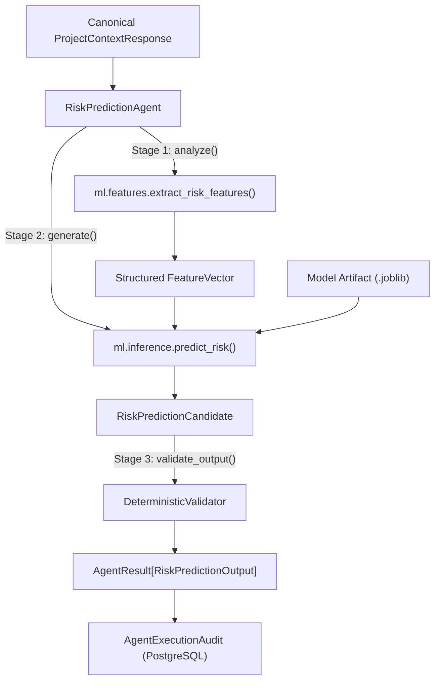

# SE IntelliPlatform ML Integration Audit

**Date:** 2026-09-22  
**Auditor:** Antigravity AI Technical Architecture Team  
**Scope:** Read-Only Technical Audit of Repository State, Contracts, Feature Availability, and ML Integration Architecture for Phase 7A (Risk Prediction, Timeline Prediction, and Bug Prediction).  
**Repository Working Copy Baseline:** Commit `b8f050c` (`feat(agent): implement database design agent`).

---

## 1. Repository Status

### Backend Architecture Overview
The backend application is structured as a modular FastAPI asynchronous service located under `backend/app/`.

```text
backend/
├── app/
│   ├── agents/                     # Phase 3 Agent Framework + Phase 4/5/6 Domain Agents
│   │   ├── architecture_recommendation/ # Phase 5 Architecture Recommendation Agent
│   │   ├── database_design/        # Phase 6 Database Design Agent
│   │   ├── providers/              # Abstract LLM provider interfaces & MockLLMProvider
│   │   ├── requirement_analysis/   # Phase 4 Requirement Analysis Agent
│   │   ├── base.py                 # AbstractBaseAgent generic contract
│   │   ├── contracts.py            # AgentResult, AgentMetadata, ValidationResult, Enums
│   │   ├── exceptions.py           # AgentError hierarchy (transient vs permanent)
│   │   ├── execution.py            # AgentExecutor single execution authority
│   │   ├── registry.py             # AgentRegistry and register_default_agents()
│   │   └── validation.py           # DeterministicValidator two-stage validation pipeline
│   ├── api/                        # HTTP Layer
│   │   ├── v1/
│   │   │   ├── endpoints/          # projects, requirements, context, agents, health
│   │   │   └── api.py              # APIRouter mounting all v1 endpoints
│   │   ├── dependencies.py         # Database session & repository dependencies
│   │   └── error_handlers.py       # RFC 7807 problem details exception mappers
│   ├── core/                       # Cross-cutting Configuration & Infrastructure
│   │   ├── config.py               # Pydantic Settings (DB, Redis, LLM, logging)
│   │   ├── database.py             # SQLAlchemy 2.0 async engine & sessionmaker
│   │   ├── exceptions.py           # Domain exceptions (NotFoundError, ConflictError, etc.)
│   │   └── logging.py              # Structured JSON/text logging with correlation IDs
│   ├── models/                     # SQLAlchemy 2.0 ORM Persistent Models
│   │   ├── agent_audit.py          # AgentExecutionAudit table
│   │   ├── base.py                 # Base declarative class & mixins (UUID, Timestamps)
│   │   ├── context_snapshot.py     # ContextSnapshot table (immutable serialized context)
│   │   ├── project.py              # Project entity table
│   │   └── requirement.py          # Requirement entity table
│   ├── schemas/                    # Pydantic v2 DTO Contracts
│   │   ├── context.py              # ProjectContextResponse, RequirementStatistics, Snapshot
│   │   ├── health.py               # Health check status DTOs
│   │   ├── project.py              # ProjectCreate, ProjectUpdate, ProjectResponse
│   │   └── requirement.py          # RequirementCreate, RequirementUpdate, RequirementResponse
│   ├── services/                   # Business Domain Logic
│   │   ├── context_engine.py       # ProjectContextEngine (deterministic metrics & snapshotting)
│   │   ├── project_service.py      # Project CRUD operations & slug generation
│   │   └── requirement_service.py  # Requirement CRUD & soft archive operations
│   └── main.py                     # FastAPI application factory and lifespan hooks
├── migrations/                     # Alembic Migration Versions (4 revisions applied)
├── tests/                          # Automated Pytest Suite (146 tests, 89.79% coverage)
│   ├── integration/                # API route integration tests
│   ├── unit/                       # Schema, service, agent, validator, and provider unit tests
│   └── conftest.py                 # Async SQLite in-memory engine and client fixtures
└── pyproject.toml                  # Package dependencies and configuration
```

### Component Status Inventory

| Path | Purpose | Status | Used By | Important Dependencies |
| :--- | :--- | :--- | :--- | :--- |
| `backend/app/agents/execution.py` | Single execution authority for all agents | **IMPLEMENTED** | API, Services, CLI | `app.agents.contracts`, `app.agents.validation`, `app.models.agent_audit` |
| `backend/app/agents/base.py` | Generic agent contract `AbstractBaseAgent` | **IMPLEMENTED** | All domain agents | `pydantic`, `app.agents.contracts` |
| `backend/app/agents/registry.py` | Discovery & extension registry | **IMPLEMENTED** | `app.api.v1.endpoints.agents` | `app.agents.base` |
| `backend/app/services/context_engine.py` | Assembles canonical context & snapshots | **IMPLEMENTED** | Agents, Context API | `app.models`, `app.schemas.context`, `SQLAlchemy` |
| `backend/app/ml/` | Dedicated machine learning subsystem | **NOT PRESENT** | None | None |
| `backend/pyproject.toml` | Build & package dependencies | **IMPLEMENTED** | Python runtime | `fastapi`, `sqlalchemy`, `pydantic`, `psycopg`, `alembic` |
| `docker-compose.yml` | Container orchestration (Postgres, Redis) | **IMPLEMENTED** | Local & staging runtime | `postgres:16-alpine`, `redis:7-alpine` |
| `backend/Dockerfile` | Production container build | **IMPLEMENTED** | Deployment | `python:3.12-slim` |
| `frontend/` | Web client application | **DEFERRED** | Reserved for Phase 7 | Placeholder `README.md` only |
| `.github/workflows/` | Continuous Integration / Deployment | **NOT PRESENT** | None | None |

---

## 2. Phase 2 Contract (Project Context Engine)

### Authoritative Schemas
The authoritative implementation is in [backend/app/schemas/context.py](file:///c:/Users/DELL/OneDrive/Documents/SE%20Intellplatform/backend/app/schemas/context.py) and [backend/app/services/context_engine.py](file:///c:/Users/DELL/OneDrive/Documents/SE%20Intellplatform/backend/app/services/context_engine.py).

#### 1. `RequirementStatistics`
```python
class RequirementStatistics(BaseModel):
    total_requirements: int
    active_requirements: int
    functional_count: int
    non_functional_count: int
    constraint_count: int
    by_priority: dict[str, int]   # e.g., {"LOW": 1, "MEDIUM": 4, "HIGH": 2, "CRITICAL": 1}
    by_status: dict[str, int]     # e.g., {"DRAFT": 2, "APPROVED": 3, "IMPLEMENTED": 3, "DEFERRED": 0, "REJECTED": 0}
    completion_percentage: float  # (IMPLEMENTED / active_requirements) * 100.0, or 0.0 if active == 0
```

#### 2. `ProjectContextResponse`
```python
class ProjectContextResponse(BaseModel):
    project: ProjectResponse
    requirements: list[RequirementResponse]  # Active only: DRAFT, APPROVED, IMPLEMENTED; non-archived
    statistics: RequirementStatistics
    context_version: int                     # Sequential integer (0 for live, >= 1 for snapshot)
    generated_at: datetime
```

#### 3. `ProjectResponse`
```python
class ProjectResponse(BaseModel):
    id: uuid.UUID
    name: str
    slug: str
    description: str | None
    status: ProjectStatus  # DRAFT, IN_PROGRESS, ARCHIVED
    settings: dict[str, Any]  # Arbitrary configuration dictionary, default {}
    created_at: datetime
    updated_at: datetime
```

#### 4. `RequirementResponse`
```python
class RequirementResponse(BaseModel):
    id: uuid.UUID
    project_id: uuid.UUID
    title: str
    description: str
    type: RequirementType      # FUNCTIONAL, NON_FUNCTIONAL, CONSTRAINT
    priority: RequirementPriority  # LOW, MEDIUM, HIGH, CRITICAL
    status: RequirementStatus  # DRAFT, APPROVED, IMPLEMENTED, DEFERRED, REJECTED
    is_archived: bool
    created_at: datetime
    updated_at: datetime
```

### Feature Availability Mapping for ML

| Feature | Exists? | Exact Field / Path | Type | Source | Can ML Inference Reproduce It? |
| :--- | :--- | :--- | :--- | :--- | :--- |
| **Project Size** | **NO** | None (Proxy: `statistics.total_requirements`) | `int` | Derived | **Partially** (as requirement count; categorical size "Small/Med/Large" is NOT stored) |
| **Team Size** | **NO** | None | N/A | Absent | **NO** |
| **Team Experience** | **NO** | None | N/A | Absent | **NO** |
| **Estimated Effort** | **NO** | None | N/A | Absent | **NO** |
| **Actual Effort** | **NO** | None | N/A | Absent | **NO** |
| **Complexity** | **NO** | None (Proxy: ratio of non-functional/constraint reqs) | `float` | Derived heuristic | **Partially** (heuristic proxy only; explicit label is NOT stored) |
| **Requirement Stability** | **NO** | None (Proxy: snapshot version count or status ratios) | `float` | Derived heuristic | **Partially** (proxy only; explicit score is NOT stored) |
| **Requirement Count** | **YES** | `context.statistics.active_requirements` | `int` | Deterministic DB | **YES** (100% reproducible) |
| **Requirement Completion** | **YES** | `context.statistics.completion_percentage` | `float` | Deterministic DB | **YES** (100% reproducible) |
| **Functional / NFR Counts** | **YES** | `context.statistics.functional_count`, `non_functional_count` | `int` | Deterministic DB | **YES** (100% reproducible) |
| **Priority Breakdown** | **YES** | `context.statistics.by_priority` | `dict[str, int]` | Deterministic DB | **YES** (100% reproducible) |
| **Ambiguities Count** | **NO (Phase 2)** / **YES (Phase 4)** | `RequirementAnalysisOutput.ambiguities` | `list` | Phase 4 Agent | **YES** (if Phase 4 output injected) |
| **Conflicts Count** | **NO (Phase 2)** / **YES (Phase 4)** | `RequirementAnalysisOutput.conflicts` | `list` | Phase 4 Agent | **YES** (if Phase 4 output injected) |
| **Missing Information** | **NO (Phase 2)** / **YES (Phase 4)** | `RequirementAnalysisOutput.missing_information` | `list` | Phase 4 Agent | **YES** (if Phase 4 output injected) |
| **Scope Issues** | **NO (Phase 2)** / **YES (Phase 4)** | `RequirementAnalysisOutput.scope_clarifications` | `list` | Phase 4 Agent | **YES** (if Phase 4 output injected) |
| **Refinements** | **NO (Phase 2)** / **YES (Phase 4)** | `RequirementAnalysisOutput.refinements` | `list` | Phase 4 Agent | **YES** (if Phase 4 output injected) |

---

## 3. Phase 3 Agent Framework

### Verified Execution Lifecycle
The framework is verified in [backend/app/agents/execution.py](file:///c:/Users/DELL/OneDrive/Documents/SE%20Intellplatform/backend/app/agents/execution.py). `AgentExecutor` is the sole execution authority.

```text
Input (context, optional agent outputs, kwargs)
        ↓
AgentExecutor.execute()
        ↓
Context Provenance Determination (Snapshot ID/Version or NULL if live)
        ↓
Audit Creation (AgentExecutionAudit in PostgreSQL, Status: PENDING)
        ↓
Lifecycle Loop (Controlled retry boundary for TransientProviderError only)
    1. agent.initialize()
    2. agent.analyze(context, **kwargs)
    3. agent.generate(analysis_data, provider, **kwargs)
    4. DeterministicValidator.run_pipeline()
           Stage 1: Pydantic Schema Validation (Structural)
           Stage 2: agent.validate_output() (Deterministic Domain Hook)
        ↓
Final AgentResult[OutputT] Assembly (Status: COMPLETED or FAILED)
        ↓
Audit Finalization (AgentExecutionAudit in PostgreSQL, Status: COMPLETED/FAILED, latency, telemetry)
        ↓
Return AgentResult
```

### Invariants Confirmed by Source Code
1. **No nested agent execution**: `AgentExecutor` does NOT invoke other agents. Dependencies must be passed via `**kwargs`.
2. **Deterministic failures are never retried**: If `AgentValidationError` is raised by schema parsing or domain validation, `AgentExecutor` breaks immediately and records `FAILED`.
3. **Transient failures are isolated**: Only `TransientProviderError` triggers retry up to `max_retries`.
4. **Audit Provenance is strict**: If execution is backed by a snapshot, `context_snapshot_id` and `context_version` record exact values. If live, they are strictly `None`.

### How a Future `RiskPredictionAgent` Uses `AgentExecutor` Without Bypassing It
`RiskPredictionAgent` must inherit from `AbstractBaseAgent[RiskPredictionOutput]` without altering `AgentExecutor`:
1. **`metadata`**: Declares `agent_id="risk-prediction"`, `agent_type=AgentType.ANALYSIS`, `version="1.0.0"`.
2. **`analyze(context, **kwargs)`**: Extracts the numerical/categorical feature vector from `context` (and optionally prior agent outputs passed in `**kwargs`).
3. **`generate(analysis_data, provider, **kwargs)`**: Invokes the local ML model pipeline (e.g., scikit-learn model artifact) to predict risk, assemble feature importance, and construct `RiskPredictionCandidate`.
4. **`validate_output(output, context)`**: Verifies deterministic business rules (e.g., risk probability in $[0.0, 1.0]$, recognized risk level enum, non-empty explanations).
5. **Execution**: Caller invokes `agent_executor.execute(risk_agent, context, ...)`. `AgentExecutor` handles lifecycle states, timing, validation, audit logging, and envelope packaging identically to LLM agents.

---

## 4. Phase 4 — Requirement Analysis Contract

**Agent ID:** `requirement-analysis` (v1.0.0, `AgentType.ANALYSIS`)  
**Source:** [backend/app/agents/requirement_analysis/contracts.py](file:///c:/Users/DELL/OneDrive/Documents/SE%20Intellplatform/backend/app/agents/requirement_analysis/contracts.py)

### Input Contract
- `context: ProjectContextResponse`
- Optional execution parameters via `**kwargs`

### Output Contract: `RequirementAnalysisOutput`
```python
class RequirementAnalysisOutput(BaseModel):
    summary: str
    ambiguities: list[RequirementAmbiguity]       # requirement_id, issue, explanation, suggested_clarification, severity
    conflicts: list[RequirementConflict]           # requirement_id, related_requirement_id, issue, explanation, severity
    missing_information: list[MissingInformation] # area, description, reason, severity
    refinements: list[RequirementRefinement]       # requirement_id, suggestion, reason, suggested_type, suggested_priority
    scope_clarifications: list[ScopeClarification] # topic, question, rationale
    completeness_score: float                     # Deterministically injected from Phase 2 RequirementStatistics
    active_requirements_count: int                # Deterministically injected from Phase 2 RequirementStatistics
    total_requirements_count: int                 # Deterministically injected from Phase 2 RequirementStatistics
```

### Potential ML Features
- `ambiguities_count = len(output.ambiguities)`
- `critical_ambiguities_count = sum(1 for a in output.ambiguities if a.severity == AnalysisSeverity.CRITICAL)`
- `conflicts_count = len(output.conflicts)`
- `missing_info_count = len(output.missing_information)`
- `refinements_count = len(output.refinements)`
- `scope_clarifications_count = len(output.scope_clarifications)`

---

## 5. Phase 5 — Architecture Recommendation Contract

**Agent ID:** `architecture-recommendation` (v1.0.0, `AgentType.RECOMMENDATION`)  
**Source:** [backend/app/agents/architecture_recommendation/contracts.py](file:///c:/Users/DELL/OneDrive/Documents/SE%20Intellplatform/backend/app/agents/architecture_recommendation/contracts.py)

### Input Contract
- `context: ProjectContextResponse`
- Optional: `requirement_analysis: RequirementAnalysisOutput | None` via `**kwargs`

### Output Contract: `ArchitectureRecommendationOutput`
```python
class ArchitectureRecommendationOutput(BaseModel):
    summary: str
    architecture_styles: list[ArchitectureStyleRecommendation] # style (Enum), rationale, confidence (float)
    components: list[ComponentRecommendation]                 # name, responsibility, reason, related_requirement_ids
    data_flows: list[DataFlowRecommendation]                 # source_component, target_component, interaction, reason
    technologies: list[TechnologyRecommendation]             # technology, category (Enum), reason, trade_off
    trade_offs: list[TradeOffAnalysis]                       # decision_area, recommended_option, advantages, disadvantages, alternative
    assumptions: list[str]
    constraints: list[str]
    unknowns: list[str]
    traceability_matrix: list[ArchitectureRequirementTrace]  # requirement_id, component_names, rationale
```

### Potential ML Features
- `primary_architecture_style`: Categorical (`MONOLITH`, `MODULAR_MONOLITH`, `MICROSERVICES`, `EVENT_DRIVEN`, etc.)
- `component_count = len(output.components)`
- `data_flow_count = len(output.data_flows)` (system coupling density proxy)
- `technology_count = len(output.technologies)`
- `database_technologies_count = sum(1 for t in output.technologies if t.category == TechnologyCategory.DATABASE)`
- `unknowns_count = len(output.unknowns)` (architectural uncertainty proxy)
- `assumptions_count = len(output.assumptions)`

---

## 6. Phase 6 — Database Design Contract

**Agent ID:** `database-design` (v1.0.0, `AgentType.RECOMMENDATION`)  
**Source:** [backend/app/agents/database_design/contracts.py](file:///c:/Users/DELL/OneDrive/Documents/SE%20Intellplatform/backend/app/agents/database_design/contracts.py)

### Input Contract
- `context: ProjectContextResponse`
- Optional: `requirement_analysis: RequirementAnalysisOutput | None` via `**kwargs`
- Optional: `architecture_recommendation: ArchitectureRecommendationOutput | None` via `**kwargs`

### Output Contract: `DatabaseDesignOutput`
```python
class DatabaseDesignOutput(BaseModel):
    summary: str
    database_paradigm: DatabaseParadigm                   # RELATIONAL, DOCUMENT, KEY_VALUE, GRAPH, SEARCH
    entities: list[EntityRecommendation]                 # name, attributes, primary_key, related_requirement_ids
    relationships: list[RelationshipRecommendation]       # source, target, type, FK entity/attrs, referenced entity/attrs
    indexes: list[IndexRecommendation]                   # entity, index_name, attributes, unique, reason
    constraints: list[ConstraintRecommendation]           # entity, constraint_type, attributes, expression_or_reference
    trade_offs: list[DatabaseTradeOff]
    assumptions: list[str]
    constraints_notes: list[str]
    unknowns: list[str]
    requirement_traceability: list[DatabaseRequirementTrace]
    architecture_traceability: list[DatabaseArchitectureTrace]
```

### Potential ML Features
- `database_paradigm`: Categorical (`RELATIONAL`, `DOCUMENT`, etc.)
- `entity_count = len(output.entities)`
- `total_attributes_count = sum(len(e.attributes) for e in output.entities)`
- `relationship_count = len(output.relationships)`
- `many_to_many_count = sum(1 for r in output.relationships if r.relationship_type == RelationshipType.MANY_TO_MANY)`
- `indexes_count = len(output.indexes)`
- `constraints_count = len(output.constraints)`

---

## 7. Existing ML Infrastructure Audit

An exhaustive ripgrep scan was conducted across all files, configuration, tests, and dependencies for machine-learning keywords:

| Keyword | Found in Repo? | Nature of Occurrence | Implementation Status |
| :--- | :--- | :--- | :--- |
| `scikit-learn` | YES | `README.md` line 196 (Roadmap vision mention only) | **NOT PRESENT** (Not in `pyproject.toml`, not installed) |
| `sklearn` | **NO** | 0 occurrences | **NOT PRESENT** |
| `pandas` | **NO** | 0 occurrences | **NOT PRESENT** |
| `numpy` | **NO** | 0 occurrences | **NOT PRESENT** |
| `joblib` | **NO** | 0 occurrences | **NOT PRESENT** |
| `pickle` | **NO** | 0 occurrences | **NOT PRESENT** |
| `xgboost` | **NO** | 0 occurrences | **NOT PRESENT** |
| `lightgbm` | **NO** | 0 occurrences | **NOT PRESENT** |
| `catboost` | **NO** | 0 occurrences | **NOT PRESENT** |
| `torch` | **NO** | 0 occurrences | **NOT PRESENT** |
| `tensorflow` | **NO** | 0 occurrences | **NOT PRESENT** |
| `transformers`| **NO** | 0 occurrences | **NOT PRESENT** |
| `huggingface` | **NO** | 0 occurrences | **NOT PRESENT** |
| `prediction`  | YES | `docs/architecture/architecture_recommendation_agent.md` line 131 | **DOCUMENTATION ONLY** |
| `feature`     | YES | Refers to software product features, not ML feature vectors | **DOMAIN USAGE ONLY** |
| `model`       | YES | Refers to SQLAlchemy ORM models and Pydantic schemas | **DATA LAYER ONLY** |

**Conclusion:** The codebase currently possesses **ZERO ML packages, ZERO trained models, ZERO feature extraction pipelines, and ZERO serialized artifacts**.

---

## 8. Project Metadata Availability (Database Schema Audit)

Persistent schema in [backend/app/models/project.py](file:///c:/Users/DELL/OneDrive/Documents/SE%20Intellplatform/backend/app/models/project.py):

| Field | Exists in DB? | Model Column | Type | Nullable | Source | Exposed in `ProjectContext`? |
| :--- | :--- | :--- | :--- | :--- | :--- | :--- |
| `id` | **YES** | `Project.id` | `UUID` | No | System generated | **YES** (`context.project.id`) |
| `name` | **YES** | `Project.name` | `VARCHAR(255)` | No | User input | **YES** (`context.project.name`) |
| `slug` | **YES** | `Project.slug` | `VARCHAR(100)` | No | Auto-generated/User | **YES** (`context.project.slug`) |
| `description`| **YES** | `Project.description` | `TEXT` | Yes | User input | **YES** (`context.project.description`) |
| `status` | **YES** | `Project.status` | `VARCHAR` (Enum) | No | System/User | **YES** (`context.project.status`) |
| `settings` | **YES** | `Project.settings` | `JSONB` / `JSON` | No (default `{}`) | User / Config | **YES** (`context.project.settings`) |
| `created_at` | **YES** | `Project.created_at` | `TIMESTAMPTZ` | No | System timestamp | **YES** (`context.project.created_at`) |
| `updated_at` | **YES** | `Project.updated_at` | `TIMESTAMPTZ` | No | System timestamp | **YES** (`context.project.updated_at`) |
| **Project Size** | **NO** | None | N/A | N/A | Absent | **NO** |
| **Team Size** | **NO** | None | N/A | N/A | Absent | **NO** |
| **Team Experience** | **NO** | None | N/A | N/A | Absent | **NO** |
| **Estimated Effort**| **NO** | None | N/A | N/A | Absent | **NO** |
| **Actual Effort** | **NO** | None | N/A | N/A | Absent | **NO** |
| **Complexity Level**| **NO** | None | N/A | N/A | Absent | **NO** |
| **Requirement Stability**| **NO** | None | N/A | N/A | Absent | **NO** |
| **Budget / Schedule**| **NO** | None | N/A | N/A | Absent | **NO** |
| **Defects Introduced**| **NO** | None | N/A | N/A | Absent | **NO** |
| **Project Risk** | **NO** | None | N/A | N/A | Absent | **NO** |

---

## 9. Risk Prediction Data Compatibility

The external dataset specification consists of 585 rows and 12 columns. Below is the mapping against current application features:

### 1. `Project_Size`
- **Current application equivalent:** None. Proxy available in `context.statistics.total_requirements`.
- **Exact application field:** None.
- **Available during inference?** **NO**, unless passed in `project.settings["project_size"]` or derived via threshold bins on requirement count.
- **Transformation required?** If dataset has categories (`Small`, `Medium`, `Large`), a binning rule on requirement count or categorical mapping is required.
- **Reliability:** Medium (if mapped to requirement count); Low (if unaligned with dataset's definition).

### 2. `Team_Experience_Level`
- **Current application equivalent:** None.
- **Exact application field:** None.
- **Available during inference?** **NO**. Neither `Project` nor `Requirement` models track engineers or teams.
- **Transformation required?** Must be explicitly supplied as execution input via `project.settings["team_experience_level"]` or API request kwargs.
- **Reliability:** High only if user/client provides it; cannot be automatically derived.

### 3. `Estimated_Effort_Hours`
- **Current application equivalent:** None.
- **Exact application field:** None.
- **Available during inference?** **NO**.
- **Transformation required?** Must be explicitly provided via `project.settings["estimated_effort_hours"]` or execution kwargs.
- **Reliability:** Cannot be derived from requirements without a separate estimation model.

### 4. `Complexity_Level`
- **Current application equivalent:** None.
- **Exact application field:** None.
- **Available during inference?** **NO**.
- **Transformation required?** Could potentially be derived as an engineering heuristic (e.g. ratio of non-functional requirements to total, or Phase 5 component count), or provided in `project.settings["complexity_level"]`.
- **Reliability:** Heuristic proxy is brittle if trained on human subjective complexity labels.

### 5. `Requirement_Stability`
- **Current application equivalent:** None.
- **Exact application field:** None.
- **Available during inference?** **NO** as a single field. (Proxies: snapshot version sequence `context.context_version`, ratio of `DRAFT` vs `APPROVED` vs `IMPLEMENTED` requirements).
- **Transformation required?** Deterministic formula over status counts or snapshot version history.
- **Reliability:** High if defined deterministically from context statistics; Low if external dataset uses an uncalibrated subjective rating.

---

## 10. Data Leakage Analysis

Classification of all 12 dataset columns for early Risk Prediction:

| Dataset Column | Lifecycle Phase | Classification | Reasoning & Leakage Hazard |
| :--- | :--- | :--- | :--- |
| `Project_ID` | Metadata | **IDENTIFIER** | Non-predictive unique key. Must be dropped to prevent overfitting. |
| `Project_Size` | Inception / Planning | **PRE-PROJECT (Valid Feature)** | Known at project kickoff based on initial scoping. |
| `Team_Experience_Level` | Team Staffing | **PRE-PROJECT (Valid Feature)** | Known prior to execution based on team composition. |
| `Estimated_Effort_Hours`| Estimation Phase | **PRE-PROJECT (Valid Feature)** | Determined during planning before implementation begins. |
| `Actual_Effort_Hours` | Project Completion | **POST-PROJECT / OUTCOME (LEAKAGE)** | **CRITICAL LEAKAGE.** Only measurable after project delivery. Using this to predict early risk violates causality. Valid target for Timeline/Effort prediction. |
| `Risk_Score` | Project Outcome / Assessment | **POSSIBLE TARGET** | Primary candidate ground-truth label for Risk Prediction. |
| `Complexity_Level` | Architecture / Planning | **PRE-PROJECT (Valid Feature)** | Assessable during early requirements/architecture phase. |
| `Requirement_Stability` | Lifecycle / Sprint | **DURING-PROJECT (Potential Leakage)** | If computed across the entire project lifecycle retroactively, it leaks future scope churn. Valid only if measured up to the snapshot version at prediction time. |
| `Budget_Deviation_Percentage` | Accounting / Post-Mortem | **POST-PROJECT / OUTCOME (LEAKAGE)** | **CRITICAL LEAKAGE.** Financial variance is only known after budget burn. Valid target for Budget Risk, not an early feature. |
| `Schedule_Deviation_Percentage`| Delivery Post-Mortem | **POST-PROJECT / OUTCOME (LEAKAGE)** | **CRITICAL LEAKAGE.** Delay is only known when milestones are completed. Valid target for Timeline Prediction. |
| `Defects_Introduced` | QA / Production | **POST-PROJECT / OUTCOME (LEAKAGE)** | **CRITICAL LEAKAGE.** Defect count is an outcome of execution. Valid target for Bug Prediction. |
| `ML_Feasibility_Score` | Unknown / Assessment | **POSSIBLE META-FEATURE or TARGET** | Origin unclear from dataset schema. If generated by an expert post-hoc, it may introduce leakage. If pre-project feasibility assessment, it can be a feature. |

---

## 11. ML Model Integration Architecture

### Proposed Directory Layout
To preserve the established architecture and single execution authority of `AgentExecutor`, ML capabilities should be organized in a dedicated package:

```text
backend/app/ml/
├── __init__.py
├── artifacts/                      # Serialized model files (.joblib) & metadata (.json)
│   ├── risk_model_v1.joblib
│   └── risk_model_v1_metadata.json
├── features/                       # Deterministic feature extraction
│   ├── __init__.py
│   └── risk_features.py            # Transforms ProjectContextResponse -> FeatureVector
├── inference/                      # Pure inference engine
│   ├── __init__.py
│   └── risk_predictor.py           # Loads model artifact & runs predict() / predict_proba()
├── schemas/                        # ML-specific data contracts
│   ├── __init__.py
│   └── risk_ml.py                  # FeatureVector schema, PredictionResult schema
└── registry/                       # Local model registry & loader
    ├── __init__.py
    └── model_loader.py             # Caches loaded scikit-learn pipelines with checksum validation
```

### Agent Framework Integration
The ML system integrates into the agent framework via a domain agent:

```text
backend/app/agents/risk_prediction/
├── __init__.py
├── agent.py                        # RiskPredictionAgent(AbstractBaseAgent[RiskPredictionOutput])
├── contracts.py                    # RiskPredictionCandidate, RiskPredictionOutput, Enums
├── prompts.py                      # Advisory narrative prompt builder (if hybrid LLM/ML)
└── validation.py                   # Deterministic validation hook (bounds, probability invariants)
```



---

## 12. Future Risk Prediction Contract Requirements

### Input Requirements
- **Primary:** `context: ProjectContextResponse`
- **Optional upstream agent outputs (via `**kwargs`):**
  - `requirement_analysis: RequirementAnalysisOutput | None` (from Phase 4)
  - `architecture_recommendation: ArchitectureRecommendationOutput | None` (from Phase 5)
  - `database_design: DatabaseDesignOutput | None` (from Phase 6)
- **Execution-injected metadata:**
  - `team_experience_level: str | None` (or from `context.project.settings`)
  - `estimated_effort_hours: float | None` (or from `context.project.settings`)
  - `project_size: str | None` (or derived from `statistics.total_requirements`)
  - `complexity_level: str | None` (or derived from requirement heuristics)

### Output Contracts: `RiskPredictionCandidate` & `RiskPredictionOutput`

```python
class RiskLevel(str, enum.Enum):
    LOW = "LOW"
    MEDIUM = "MEDIUM"
    HIGH = "HIGH"
    CRITICAL = "CRITICAL"

class RiskFactor(BaseModel):
    feature_name: str
    feature_value: Any
    contribution_direction: str  # "INCREASES_RISK" | "DECREASES_RISK"
    importance_weight: float     # Feature importance or SHAP value (0.0 to 1.0)
    explanation: str

class ModelMetadata(BaseModel):
    model_name: str
    model_version: str
    algorithm: str
    training_dataset_id: str
    feature_schema_version: str
    artifact_checksum: str

class RiskPredictionOutput(BaseModel):
    summary: str
    risk_level: RiskLevel
    risk_score: float                     # Normalized 0.0 to 1.0 (or calibrated probability)
    confidence: float                     # Model confidence (0.0 to 1.0)
    risk_factors: list[RiskFactor]        # Top contributing features
    feature_summary: dict[str, Any]       # Exact feature vector consumed during inference
    model_provenance: ModelMetadata
    limitations: list[str]
```

---

## 13. Model Provenance & Telemetry Tracking

Existing architecture in [backend/app/models/agent_audit.py](file:///c:/Users/DELL/OneDrive/Documents/SE%20Intellplatform/backend/app/models/agent_audit.py) already possesses the necessary infrastructure:
- `AgentExecutionAudit.metadata_payload` stores JSONB.
- `AgentResult.metadata` carries execution telemetry.

To record complete ML provenance:
```json
{
  "ml_provenance": {
    "model_name": "se_risk_random_forest",
    "model_version": "1.0.0",
    "algorithm": "RandomForestClassifier",
    "training_dataset": "se_risk_585_v1",
    "feature_schema_version": "1.0.0",
    "artifact_sha256": "e3b0c44298fc1c149afbf4c8996fb92427ae41e4649b934ca495991b7852b855",
    "features_consumed": {
      "project_size": 24,
      "team_experience_level": 2,
      "estimated_effort_hours": 320.0,
      "complexity_level": 1,
      "requirement_stability": 0.85
    }
  }
}
```

---

## 14. Testing Infrastructure

### Current Test Architecture
- **Framework:** Pytest 8.1.0 with `pytest-asyncio` and `pytest-cov`.
- **Database Fixture:** In-memory asynchronous SQLite (`sqlite+aiosqlite:///:memory:`) in `tests/conftest.py`. Automatically creates all tables before each test and drops them after.
- **Client Fixture:** `httpx.AsyncClient` with FastAPI dependency overrides (`get_db`).
- **Pass Baseline:** 146 passed tests, 0 failures, 89.79% coverage.

### Recommended Pattern for Future ML Tests
Following existing unit test conventions (`test_agent_abstraction.py`, `test_requirement_analysis_agent.py`):
1. `tests/unit/test_ml_feature_extraction.py`: Verify deterministic extraction of `FeatureVector` from `ProjectContextResponse`.
2. `tests/unit/test_ml_inference.py`: Verify model prediction with canned mock weights / small joblib model fixture.
3. `tests/unit/test_risk_prediction_agent.py`: Verify `RiskPredictionAgent` execution via `AgentExecutor`, schema validation, deterministic bounds validation, and audit logging.
4. `tests/unit/test_ml_model_loader.py`: Verify artifact caching, checksum validation, and `MODEL_UNAVAILABLE` error handling.

---

## 15. Missing Information & Gaps

1. **No ML Libraries:** `scikit-learn`, `numpy`, and `joblib` are not declared in `pyproject.toml`.
2. **Missing Application Schema Fields:** `Project` and `Requirement` models do NOT have fields for `team_experience_level`, `estimated_effort_hours`, `actual_effort_hours`, `complexity_level`, or `budget`.
3. **Dataset Encoding Specifications:** The external 585-row dataset's categorical encodings (e.g., whether `Team_Experience_Level` is integer 1–5 or string `"High"`, whether `Project_Size` is line counts or categorical labels) are not defined in the repository.
4. **Target Variable Definition:** It is not confirmed whether `Risk_Score` in the external dataset is continuous ($0.0–1.0$ or $0–100$) or discrete risk tiers ($1, 2, 3$).

---

## 16. Architectural Questions & Authoritative Answers

### Q1: What is the canonical input to agents?
**Answer:** `ProjectContextResponse` (from `app.schemas.context`), generated by `ProjectContextEngine`. It contains `project` metadata, active `requirements`, and deterministic `statistics`.

### Q2: Can future ML agents consume ProjectContext directly?
**Answer:** **YES.** `AbstractBaseAgent.analyze(self, context: ProjectContextResponse, **kwargs)` takes `ProjectContextResponse` as its primary input.

### Q3: Can future ML agents consume outputs of previous agents without executing those agents internally?
**Answer:** **YES.** Upstream outputs (e.g. `RequirementAnalysisOutput`, `ArchitectureRecommendationOutput`, `DatabaseDesignOutput`) are injected as optional keyword arguments (`**kwargs`) into `AgentExecutor.execute(agent, context, **kwargs)`. Agents never invoke upstream agents internally.

### Q4: Where should deterministic feature extraction live?
**Answer:** In `app.ml.features.risk_features`, invoked inside the agent's `analyze()` hook.

### Q5: Where should model inference live?
**Answer:** In `app.ml.inference.risk_predictor`, invoked inside the agent's `generate()` hook.

### Q6: Where should model artifacts live?
**Answer:** In a dedicated directory, e.g. `backend/app/ml/artifacts/`, with paths configurable via `app.core.config.Settings.MODEL_ARTIFACTS_DIR`.

### Q7: Where should model metadata/provenance live?
**Answer:** In `RiskPredictionOutput.model_provenance`, recorded persistently in `AgentExecutionAudit.metadata_payload` (PostgreSQL JSONB) and returned in `AgentResult.metadata`.

### Q8: How should ML validation integrate with AgentExecutor?
**Answer:** Directly via `DeterministicValidator.run_pipeline()`. Stage 1 parses the prediction dictionary into `RiskPredictionCandidate`/`Output` via Pydantic; Stage 2 executes `agent.validate_output()`, validating probability bounds ($[0.0, 1.0]$) and feature non-negativity.

### Q9: How should a model-unavailable state be represented?
**Answer:** By raising `ProviderError(message="Risk model artifact not found or corrupted", provider_name="ml_model", transient=False)` or returning a structured fallback result with `status=AgentExecutionStatus.FAILED`.

### Q10: Can a real trained model be integrated without changing the existing AgentExecutor contract?
**Answer:** **YES.** `AgentExecutor` executes `agent.initialize()` -> `agent.analyze()` -> `agent.generate()` -> `agent.validate_output()`. The agent implementation can run scikit-learn model inference inside `generate()`. `AgentExecutor` does not require any code modifications.

### Q11: What application fields are currently missing for Risk Prediction?
**Answer:** `team_experience_level`, `estimated_effort_hours`, `actual_effort_hours`, `complexity_level`, `project_size` (categorical), `budget_deviation`, and `defects_introduced`.

### Q12: Would adding missing fields require a database migration, or can the existing project context derive them?
**Answer:** Two viable architectural paths exist:
- **Option A (Zero Migrations):** Use the existing `projects.settings` JSONB column (e.g., `project.settings["team_experience_level"] = "HIGH"`, `project.settings["estimated_effort_hours"] = 160.0`). The `settings` column already exists in the database and is fully exposed in `ProjectContextResponse.project.settings`.
- **Option B (Formal Database Migration):** Add formal columns to the `projects` table via Alembic (`0005_project_ml_features.py`). Option A is immediately viable without schema migration.

---

## 17. Risks & Blockers

1. **Feature Starvation Risk:** If the model requires `Team_Experience_Level` and `Estimated_Effort_Hours`, but the project creator did not configure them in `project.settings`, inference will fail or require imputation.
2. **Data Leakage Hazard:** Training the risk model on `Actual_Effort_Hours`, `Budget_Deviation_Percentage`, `Schedule_Deviation_Percentage`, or `Defects_Introduced` will cause severe data leakage and produce invalid predictive claims.
3. **Missing ML Runtime Dependencies:** Attempting to load a scikit-learn model in the current environment will fail with `ModuleNotFoundError: No module named 'sklearn'`.

---

## 18. Final Readiness Assessment

| Area | Status | Evidence | Blocking? |
| :--- | :--- | :--- | :--- |
| **Phase 2 Context** | **COMPLETE** | `ProjectContextEngine`, `ProjectContextResponse`, snapshots | **NO** |
| **Phase 3 Agent Framework** | **COMPLETE** | `AbstractBaseAgent`, `AgentExecutor`, `DeterministicValidator` | **NO** |
| **Phase 4 Requirement Analysis** | **COMPLETE** | `RequirementAnalysisAgent`, contracts, tests | **NO** |
| **Phase 5 Architecture** | **COMPLETE** | `ArchitectureRecommendationAgent`, contracts, tests | **NO** |
| **Phase 6 Database Design** | **COMPLETE** | `DatabaseDesignAgent`, contracts, tests | **NO** |
| **ML Infrastructure** | **NOT PRESENT** | No `scikit-learn`, `joblib`, or ML directories in repo | **YES** (Needs dependencies & scaffold) |
| **Risk Dataset Compatibility** | **PARTIAL** | Only 1 of 5 input features exists natively (`Requirement Count`); 4 missing | **YES** (Must define feature ingestion strategy) |
| **Live Feature Availability** | **PARTIAL** | Can be resolved via `project.settings` JSONB without DB migration | **NO** (If Option A is adopted) |
| **Model Integration Point** | **CLEAR** | `app/ml/` + `RiskPredictionAgent(AbstractBaseAgent)` | **NO** |
| **ML Training Readiness** | **PENDING** | Dataset schema and leakage boundaries must be finalized | **YES** |

---

## Critical Findings
1. **The application code has zero machine-learning infrastructure:** There are no ML dependencies (`scikit-learn`, `numpy`, `joblib`), no model training scripts, and no model artifacts.
2. **Severe data leakage hazard in the 585-row dataset:** Four columns (`Actual_Effort_Hours`, `Budget_Deviation_Percentage`, `Schedule_Deviation_Percentage`, `Defects_Introduced`) are post-project outcome metrics. They must be strictly excluded from the Risk Prediction training feature set.
3. **Missing input features can be accommodated without database migrations:** The existing `projects.settings` JSONB column already flows into `ProjectContextResponse.project.settings`, allowing pre-project features (`team_experience_level`, `estimated_effort_hours`) to be supplied without altering the database schema.
4. **AgentExecutor is 100% compatible with ML inference as-is:** `AgentExecutor` requires no modifications to execute an ML agent.

---

## Information Required From CTO
1. **Feature Ingestion Strategy:** Should missing pre-project features (`team_experience_level`, `estimated_effort_hours`, `complexity_level`) be stored in `projects.settings` JSONB (Option A: zero migration) or as explicit columns via Alembic migration (Option B)?
2. **Dataset Column Encodings & Target Specification:** What are the exact categorical encodings and data types of `Project_Size`, `Team_Experience_Level`, and `Complexity_Level` in the 585-row dataset, and is `Risk_Score` a continuous probability $[0, 1]$, a percentage $[0, 100]$, or a discrete classification label?
3. **Packaging Strategy:** Should ML dependencies (`scikit-learn`, `joblib`, `numpy`) be added as core dependencies in `pyproject.toml` or as an optional dependency group (e.g. `[project.optional-dependencies] ml = [...]`)?

---

## Recommended Next Step
**CTO Decision on Feature Ingestion:** The CTO should approve the feature ingestion path (recommending Option A via `project.settings` JSONB to avoid unnecessary database schema migrations) and provide the exact schema/encodings of the 585-row external dataset before authoring the Phase 7A implementation prompt.
