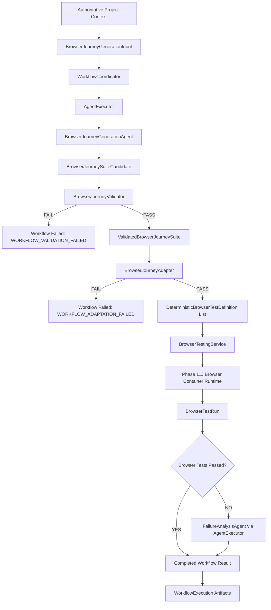

# Phase 11K Stage 4 Implementation Report
## Intelligent Browser Journey Generation Orchestrator + Workflow Integration

### Executive Summary

Phase 11K Stage 4 connects the frozen browser journey components (Stage 1 AI Generation Agent, Stage 2 Deterministic Validation & Coverage Engine, Stage 3 Adapter & Deterministic Runner) into one deterministic platform workflow without replacing, duplicating, or bypassing any authoritative platform components.

The implementation strictly honors:
- **No second orchestrator**: Existing `WorkflowCoordinator` remains the sole multi-agent workflow coordination authority. `BrowserJourneyWorkflowOrchestrator` is a thin domain orchestrator over `WorkflowCoordinator`.
- **No AgentExecutor bypass**: `BrowserJourneyGenerationAgent` executes strictly through `AgentExecutor`.
- **Deterministic boundaries**: AI generation is bounded and probabilistic; validation, coverage calculation, adaptation, workflow routing, execution eligibility, artifact structure, and failure classification remain 100% deterministic.
- **Fail-fast stopping**: Validation failure halts the pipeline immediately—raw candidate suites cannot reach `BrowserJourneyAdapter`, and invalid definitions cannot reach `BrowserTestingService`.
- **Strict failure taxonomy**: Generation failure (`WORKFLOW_GENERATION_FAILED`), Validation failure (`WORKFLOW_VALIDATION_FAILED`), Adaptation failure (`WORKFLOW_ADAPTATION_FAILED`), and Browser execution failure (`WORKFLOW_BROWSER_EXECUTION_FAILED`) are cleanly separated. Validation failures are never conflated with browser execution failures.
- **Full traceability**: Requirement $\to$ Journey $\to$ Deterministic Test Definition $\to$ Browser Test Result.
- **Zero autonomous loops**: No automatic regeneration, no self-healing selectors, no autonomous application code modification, and no database mutations.

---

### 1. Baseline Verification

Before initiating Stage 4 implementation, the platform baseline was inspected and verified:
- **Phase 11J Browser Runtime**: Frozen, passing all 81 browser tests across contracts, service, verification, and API.
- **Phase 11K Stage 1 Generation Agent**: Frozen, passing all 62 contract and agent tests.
- **Phase 11K Stage 2 Validation & Coverage**: Frozen, passing all 19 validation and coverage tests.
- **Phase 11K Stage 3 Adapter & Runner Integration**: Frozen, passing all 38 adapter tests.
- **Total Backend Baseline**: 1,021 tests passing (100% green).
- **Frontend Baseline**: 14 test suites, 59 tests passing (100% green).
- **Git Working Tree**: Clean baseline on branch `master`, zero commits or pushes.

---

### 2. Existing WorkflowCoordinator Inspection

The platform's existing `WorkflowCoordinator` (`backend/app/workflows/coordinator.py`) was inspected:
- It supports sequential agent execution, workflow steps, artifact passing via `WorkflowExecution`, step-level metadata recording, and deterministic error propagation.
- Step execution maps agent IDs dynamically via `AgentRegistry` and executes agents via `AgentExecutor.execute(...)`.
- We registered `WORKFLOW_BROWSER_JOURNEY_ID = "browser-journey-workflow"` in `backend/app/workflows/pipelines.py` with definition:
  - Step 1: `browser-journey-generation` executing `BrowserJourneyGenerationAgent` with input kwargs resolved from `WorkflowInput.browser_journey_input`.
- In `backend/app/services/workflow_service.py`, `WORKFLOW_BROWSER_JOURNEY_ID` is registered in `EXTENSION_WORKFLOWS`.
- The existing `WorkflowCoordinator` was reused without creating any competing workflow engine or second coordinator.

---

### 3. Existing AgentExecutor Integration

`AgentExecutor` (`backend/app/agents/execution.py`) remains the sole single-agent execution authority:
- `BrowserJourneyGenerationAgent` is executed strictly by calling `coordinator.execute(...)` $\to$ `AgentExecutor.execute(...)`.
- When browser tests fail, the orchestrator invokes the existing `FailureAnalysisAgent` strictly through `AgentExecutor.execute(...)`.
- Zero direct calls to LLM providers (Groq/Gemini/Mock) occur from the Stage 4 orchestrator.
- Input validation, context sanitization, prompt grounding, and output validation all remain governed by `AgentExecutor`.

---

### 4. Stage 4 Workflow Architecture

The Stage 4 workflow connects the components according to the required pipeline:

The domain orchestrator class `BrowserJourneyWorkflowOrchestrator` (`backend/app/browser/journey/orchestrator.py`) handles pipeline sequencing:
1. `build_generation_input(...)`: Deterministically constructs a bounded, sanitized `BrowserJourneyGenerationInput`.
2. `execute_workflow(...)`: Orchestrates the sequence, captures failures at exact stage boundaries, records serialized artifacts, and returns a structured `BrowserJourneyWorkflowResult`.

---

### 5. Input Construction

`BrowserJourneyWorkflowOrchestrator.build_generation_input`:
- Extracts requirements from `ProjectContextResponse`. Filters out archived requirements, sanitizes IDs and descriptions, and caps total requirements at `MAX_REQUIREMENTS_IN_CONTEXT = 20`.
- Limits route list to approved authoritative routes, filtering out routes exceeding `MAX_ROUTE_LENGTH = 100` and capping at `MAX_ROUTES_IN_CONTEXT = 20`.
- Filters file manifests to include only relevant frontend/code files (`.ts`, `.tsx`, `.js`, `.jsx`, `.html`, `.css`, `.vue`, `.svelte`), explicitly omitting sensitive files (`.env`, secrets, credentials, password files, binary assets, and directory traversal indicators `..`).
- Enforces prompt injection mitigation: all project source code, file paths, and requirement descriptions are treated as data, preserving Stage 1 `<untrusted_content>` sandboxing in prompts.

---

### 6. Candidate Generation

- Executed by dispatching `WORKFLOW_BROWSER_JOURNEY_ID` to `WorkflowCoordinator.execute(...)`.
- `WorkflowCoordinator` delegates step `browser-journey-generation` to `AgentExecutor.execute(...)`.
- `BrowserJourneyGenerationAgent` produces a `BrowserJourneySuiteCandidate` containing proposed journeys and step definitions.
- If generation fails (e.g. LLM provider error, output format validation error), the pipeline stops immediately with status `WORKFLOW_GENERATION_FAILED`. No downstream validation, adaptation, or browser execution occurs.

---

### 7. Validation Stage

- Candidate suite is handed to `BrowserJourneyValidator.validate_candidate(candidate=..., context=...)`.
- Deterministic checks enforce:
  - Project ID integrity (project isolation).
  - Requirement validity (all referenced requirement IDs must exist in authoritative project context).
  - Route validity (all navigated or target routes must exist in authoritative routes).
  - Action validity (permitted action types, required fields for `NAVIGATE`, `CLICK`, `FILL`, `ASSERT_VISIBLE`, etc.).
  - Selector safety (no dangerous selectors, script injection, or CSS length violations).
  - Suite and journey limits (max journeys $\le 10$, max steps per journey $\le 20$, total steps $\le 100$).
- If validation finds any errors (`is_valid is False`):
  - Pipeline terminates deterministically with `WORKFLOW_VALIDATION_FAILED`.
  - The invalid candidate is **never** passed to `BrowserJourneyAdapter`.
  - Browser container execution is **never** invoked.

---

### 8. Coverage Preservation

- Stage 2 `RequirementCoverageEngine` computes requirement coverage during validation.
- The resulting `RequirementCoverageReport` (covered requirement IDs, uncovered requirement IDs, coverage percentage) is attached directly to the `ValidatedBrowserJourneySuite`.
- Stage 4 preserves this report verbatim without recalculation. There is strictly one authoritative coverage calculation across the platform.

---

### 9. Adapter Stage

- When validation passes, the `ValidatedBrowserJourneySuite` is adapted using `BrowserJourneyAdapter.adapt(...)`.
- Converts validated journeys into a list of `DeterministicBrowserTestDefinition` objects compatible with Phase 11J.
- Step actions are mapped to deterministic Phase 11J `BrowserAction` items.
- Full requirement traceability is injected into each test definition's `metadata`:
  - `metadata["journey_id"] = validated_journey.journey_id`
  - `metadata["requirement_ids"] = validated_journey.validated_requirement_ids`
  - `metadata["journey_title"] = validated_journey.title`
  - `metadata["category"] = validated_journey.category.value`
- If adaptation fails (e.g., unexpected mapping failure), the pipeline stops with `WORKFLOW_ADAPTATION_FAILED`. No browser execution occurs.

---

### 10. BrowserTestingService Integration

- Adapted deterministic test definitions are executed by delegating to `BrowserTestingService.execute_validated_browser_journey_suite(...)` (or `execute_browser_tests(...)`).
- The execution chain remains:
  $$\text{Stage 4 Orchestrator} \to \text{BrowserTestingService} \to \text{ApplicationRuntimeManager} \to \text{DockerRuntimeExecutor} \to \text{Phase 11J Browser Container} \to \text{Playwright}$$
- Zero direct Docker invocations, zero direct Playwright invocations, and zero direct shell commands in Stage 4.

---

### 11. Failure Boundaries

The orchestrator enforces strict, deterministic failure boundaries:

| Stage | Failure Trigger | Status Emitted | Downstream Execution |
| :--- | :--- | :--- | :--- |
| **Generation** | LLM provider error, schema parsing error | `WORKFLOW_GENERATION_FAILED` | Validation: No Adaptation: No Browser: No |
| **Validation** | Unknown route, foreign requirement, invalid action, unsafe selector | `WORKFLOW_VALIDATION_FAILED` | Adaptation: No Browser: No |
| **Adaptation** | Contract mismatch, transformation error | `WORKFLOW_ADAPTATION_FAILED` | Browser: No |
| **Browser Execution** | Assertion timeout, element not found, container failure | `WORKFLOW_BROWSER_EXECUTION_FAILED` | Generation: Succeeded Validation: Succeeded Adaptation: Succeeded Failure Analysis: Invoked |

Validation failure is never confused with browser execution failure:
- In validation failure, no browser container was ever spun up.
- In browser execution failure, generation, validation, and adaptation succeeded; the failure occurred within the running application under test.

---

### 12. FailureAnalysisAgent Integration

When a browser test run completes with status `FAILED`:
- The orchestrator checks if a `FailureAnalysisAgent` is available.
- Builds a `FailureAnalysisInput` containing:
  - `project_id`
  - `browser_test_run`
  - `available_test_ids` (mapped from journey test cases)
  - `available_requirement_ids` (mapped from validated journeys)
- Dispatches analysis through `AgentExecutor.execute(agent=fa_agent, ...)` strictly.
- The resulting `FailureDiagnosis` is recorded in `BrowserJourneyWorkflowResult.failure_diagnosis` and serialized into workflow artifacts under key `"failure_analysis"`.
- Analysis is diagnostic only: no automatic code patching or autonomous remediation occurs.

---

### 13. WorkflowExecution Artifact Handling

Domain artifacts are preserved in `BrowserJourneyWorkflowResult.artifacts` using standard serialized dictionaries:
- `"browser_journey_input"`: Serialized `BrowserJourneyGenerationInput`
- `"browser_journey_generation"`: Serialized candidate suite metadata
- `"browser_journey_validation"`: Serialized `ValidationOutcome` (issues, coverage summary)
- `"browser_journey_suite"`: Serialized `ValidatedBrowserJourneySuite`
- `"browser_test_run"`: Serialized `BrowserTestRun` (if tests executed)
- `"failure_analysis"`: Serialized `FailureDiagnosis` (if failure analysis was performed)

Preserves `workflow_execution_id`, timestamps, and status without mutating historical `DevelopmentVersion` content or modifying database schemas.

---

### 14. Requirement $\to$ Journey $\to$ Test $\to$ Result Traceability

The complete traceability chain is preserved throughout the pipeline:
1. **Requirement**: Sourced from `ProjectContextResponse.requirements` (e.g. `REQ-001`).
2. **Generation Candidate**: `BrowserJourney.requirement_ids = ["REQ-001"]`.
3. **Validated Journey**: `ValidatedBrowserJourney.validated_requirement_ids = ["REQ-001"]`.
4. **Deterministic Test Definition**: `DeterministicBrowserTestDefinition.metadata["requirement_ids"] = ["REQ-001"]`, `metadata["journey_id"] = "BJ-001"`.
5. **Browser Test Run**: `BrowserTestCaseResult.metadata["requirement_ids"] = ["REQ-001"]`, `metadata["journey_id"] = "BJ-001"`.

Any consumer can verify precisely: which requirement was tested by which journey, which container test executed it, and whether it passed or failed.

---

### 15. Security Boundaries

Stage 4 code was strictly audited and verified against security invariants:
- **No subprocess/shell execution**: Zero occurrences of `subprocess`, `shell=True`, `os.system`.
- **No dynamic code evaluation**: Zero occurrences of `eval(`, `exec(`.
- **No Docker bypass**: Zero occurrences of `docker.sock`, `--privileged`, `--network host`.
- **No Playwright bypass**: Zero occurrences of `page.evaluate` or direct `playwright` imports in Stage 4.
- **No direct LLM calls**: Zero direct calls to Groq or Gemini SDKs. All requests flow through `AgentExecutor`.
- **Input sanitization**: File manifest sanitization excludes `.env`, secrets, passwords, credentials, and directory traversal tokens (`..`).
- **Prompt injection defense**: Untrusted project source code and requirements are treated strictly as data within `<untrusted_content>` tags.

---

### 16. Unit & Pipeline Tests

13 new unit tests were created in `backend/tests/unit/test_browser_journey_orchestrator.py` covering:
- **TestEndToEndOrchestration**:
  1. `test_successful_end_to_end_orchestration`: Complete generation $\to$ validation $\to$ adaptation $\to$ browser service execution $\to$ artifact compilation.
  2. `test_generate_and_validate_only_mode`: Dry-run mode without browser test execution.
- **TestFailureBoundaries**:
  3. `test_generation_failure_blocks_downstream_stages`: LLM failure halts pipeline at generation stage.
  4. `test_validation_failure_blocks_adaptation_and_execution`: Unapproved routes/hallucinated requirements halt pipeline at validation stage.
  5. `test_adaptation_failure_blocks_execution`: Adaptation errors halt pipeline deterministically.
  6. `test_browser_execution_failure_triggers_failure_analysis`: Browser test failure triggers `FailureAnalysisAgent` via `AgentExecutor`.
- **TestTraceabilityAndCoverage**:
  7. `test_traceability_chain_preserved`: Verifies Requirement $\to$ Journey $\to$ Test $\to$ Result metadata linkage.
  8. `test_coverage_report_preserved_without_recalculation`: Confirms Stage 2 coverage report is unchanged.
- **TestAuthorityBoundariesAndSecurity**:
  9. `test_agent_executor_and_workflow_coordinator_enforced`: Proves multi-stage coordination flows through `WorkflowCoordinator` and agent execution flows through `AgentExecutor`.
  10. `test_build_generation_input_sanitizes_files_and_manifests`: Verifies `.env`, secrets, and traversal paths are stripped.
  11. `test_project_isolation_enforced`: Rejection of foreign project requirements.
  12. `test_no_direct_llm_provider_calls`: Proves provider calls are routed solely via `AgentExecutor`.
  13. `test_no_direct_playwright_or_docker_in_orchestrator`: Source code inspection confirming absence of direct Playwright/Docker/subprocess imports.

**Result**: 13 of 13 tests passed (100% green).

---

### 17. Total Browser Journey Test Count

All Browser Journey test suites (Stages 1 through 4) were executed:
- `tests/unit/test_browser_journey_contracts.py`: 50 passed
- `tests/unit/test_browser_journey_agent.py`: 12 passed
- `tests/unit/test_browser_journey_validator.py`: 13 passed
- `tests/unit/test_browser_journey_coverage.py`: 6 passed
- `tests/unit/test_browser_journey_adapter.py`: 38 passed
- `tests/unit/test_browser_journey_orchestrator.py`: 13 passed

**Total Browser Journey Tests**: 132 passed (100% green in 9.05s).

---

### 18. Full Regression Results

#### Backend Regression
- Total tests collected: **1,034**
- Total tests passed: **1,034**
- Failures: **0**
- Errors: **0**
- Execution time: ~2 minutes (100% green across all unit and integration suites)

#### Frontend Regression
- Test files: **14 passed**
- Total tests: **59 passed**
- Failures: **0**
- Build check: `npm run build` completed with **0 errors**

---

### 19. Security Audit Results

A full grep audit on Stage 4 code (`backend/app/browser/journey/orchestrator.py`) verified:
- `subprocess`: 0 occurrences
- `shell=True`: 0 occurrences
- `os.system`: 0 occurrences
- `eval(`: 0 occurrences
- `exec(`: 0 occurrences
- `docker.sock`: 0 occurrences
- `--privileged`: 0 occurrences
- `--network host`: 0 occurrences
- `page.evaluate`: 0 occurrences
- `Groq direct calls`: 0 occurrences
- `Gemini direct calls`: 0 occurrences

Audit result: **PASSED**.

---

### 20. Files Created

1. `backend/app/browser/journey/orchestrator.py`: `BrowserJourneyWorkflowOrchestrator` implementing input sanitization, pipeline sequencing, stage failure boundaries, failure analysis integration, and artifact compilation.
2. `backend/tests/unit/test_browser_journey_orchestrator.py`: 13 unit tests for Stage 4 pipeline coordination, security, and traceability.
3. `docs/architecture/Phase_11K_Stage4_Implementation_Report.md`: This comprehensive implementation report.

---

### 21. Files Modified

1. `backend/app/workflows/contracts.py`: Added optional `browser_journey_input` field to `WorkflowInput`.
2. `backend/app/workflows/pipelines.py`: Registered `WORKFLOW_BROWSER_JOURNEY_ID = "browser-journey-workflow"`, defined `build_browser_journey_workflow()`, and added `browser-journey-generation` step kwarg resolution.
3. `backend/app/services/workflow_service.py`: Registered `WORKFLOW_BROWSER_JOURNEY_ID` in `WorkflowService.EXTENSION_WORKFLOWS`.
4. `backend/app/browser/journey/contracts.py`: Added `BrowserJourneyWorkflowStatus` enum and `BrowserJourneyWorkflowResult` model.
5. `backend/app/browser/journey/__init__.py`: Exported `BrowserJourneyWorkflowOrchestrator`, `BrowserJourneyWorkflowResult`, `BrowserJourneyWorkflowStatus`.
6. `backend/app/browser/__init__.py`: Exported `BrowserJourneyWorkflowOrchestrator`, `BrowserJourneyWorkflowResult`, `BrowserJourneyWorkflowStatus`.

---

### 22. Deferred to Stage 5 and Later

In strict compliance with Stage 4 instructions, the following items are deferred:
- **Stage 5 (REST APIs & Assistant Integration)**:
  - `POST /api/v1/projects/{project_id}/browser-journeys`
  - `GET /api/v1/projects/{project_id}/browser-journeys`
  - `GET /api/v1/projects/{project_id}/browser-journeys/{journey_id}`
  - `GENERATE_BROWSER_JOURNEYS` engineering action registration
  - `AssistantReasoningService` and `EngineeringActionService` action dispatching
- **Stage 6 (Frontend UI)**:
  - Browser journey generation and review UI in `DevelopmentWorkspace` / `TestingWorkspace`
  - Interactive journey step visualizer and requirement coverage badges
- **Autonomous Remediation**:
  - No automated code changes or self-healing selectors. Human-in-the-loop approval remains mandatory.

---

### 23. Git Status

- Current branch: `master`
- Commits made: **0**
- Pushes made: **0**
- Changes remain uncommitted in the local working tree awaiting explicit user review.

---

### 24. Definition of Done Compliance Matrix

| Requirement | Status | Evidence |
| :--- | :--- | :--- |
| Existing WorkflowCoordinator is reused | **COMPLIED** | Registered in `EXTENSION_WORKFLOWS`, executed via `coordinator.execute(...)` |
| AgentExecutor remains sole agent execution authority | **COMPLIED** | Generation & FA agents executed strictly via `AgentExecutor.execute(...)` |
| BrowserJourneyGenerationAgent executed through AgentExecutor | **COMPLIED** | Verified in `test_agent_executor_and_workflow_coordinator_enforced` |
| Authoritative context constructed deterministically | **COMPLIED** | `build_generation_input` bounded and sanitized |
| Candidate generation works | **COMPLIED** | Verified in end-to-end tests |
| Deterministic validation follows generation | **COMPLIED** | `BrowserJourneyValidator.validate_candidate` executes before any downstream stage |
| Invalid candidates cannot proceed | **COMPLIED** | Verified in `test_validation_failure_blocks_adaptation_and_execution` |
| Stage 2 coverage is preserved | **COMPLIED** | Stage 2 `RequirementCoverageReport` attached directly without recalculation |
| BrowserJourneyAdapter is used | **COMPLIED** | `BrowserJourneyAdapter.adapt` produces deterministic definitions |
| Deterministic definitions reach BrowserTestingService | **COMPLIED** | Delegated via `BrowserTestingService.execute_validated_browser_journey_suite` |
| Existing Phase 11J runtime executes them | **COMPLIED** | Standard Phase 11J container runtime execution path |
| Browser results remain traceable | **COMPLIED** | Verified in `test_traceability_chain_preserved` |
| FailureAnalysisAgent is reused | **COMPLIED** | Invoked on browser failure via `AgentExecutor`; no new FA agent created |
| WorkflowExecution artifacts preserve workflow chain | **COMPLIED** | Serialized artifacts under standard keys in result |
| No direct Playwright from Stage 4 | **COMPLIED** | Verified by code inspection test |
| No direct Docker from Stage 4 | **COMPLIED** | Verified by code inspection test |
| No direct LLM provider calls | **COMPLIED** | Verified by `test_no_direct_llm_provider_calls` |
| No autonomous remediation | **COMPLIED** | Failure analysis is strictly diagnostic |
| No automatic regeneration | **COMPLIED** | Failures stop pipeline immediately |
| No DevelopmentVersion mutation | **COMPLIED** | No historical version mutation |
| No database migration | **COMPLIED** | Zero migration scripts created |
| No REST API | **COMPLIED** | Deferred to Stage 5 |
| No Assistant changes | **COMPLIED** | Deferred to Stage 5 |
| No frontend changes | **COMPLIED** | Deferred to Stage 6 |
| All Stage 1 tests remain green | **COMPLIED** | 12 of 12 tests passed |
| All Stage 2 tests remain green | **COMPLIED** | 19 of 19 tests passed |
| All Stage 3 tests remain green | **COMPLIED** | 38 of 38 tests passed |
| Stage 4 tests pass | **COMPLIED** | 13 of 13 tests passed |
| Complete backend regression passes | **COMPLIED** | 1,034 of 1,034 tests passed |
| Frontend regression passes | **COMPLIED** | 59 of 59 tests passed; build clean |
| Security audit passes | **COMPLIED** | 0 banned tokens / unsafe patterns |
| Architecture report created | **COMPLIED** | `docs/architecture/Phase_11K_Stage4_Implementation_Report.md` |
| No Git commit/push | **COMPLIED** | Zero commits / pushes |
