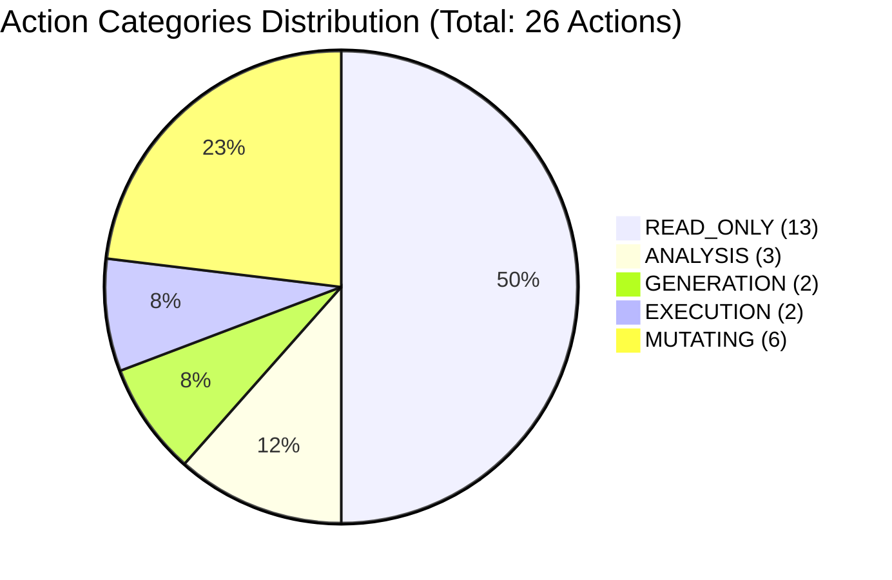
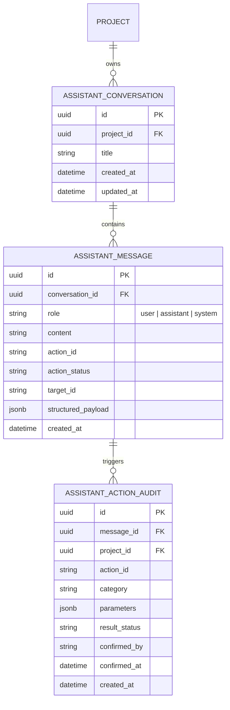
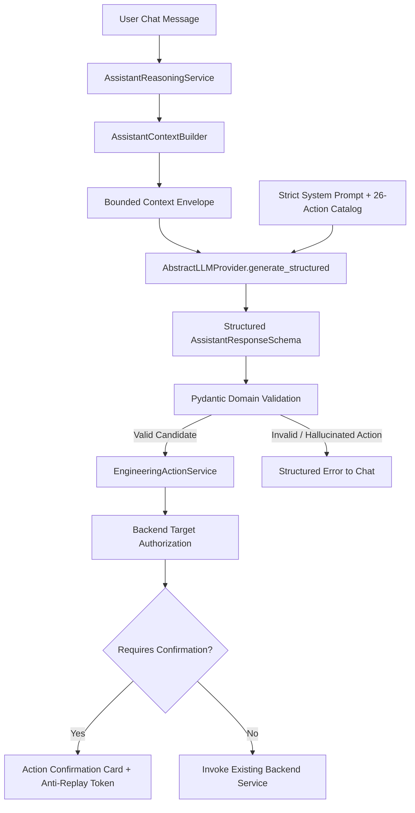

# Phase 11I Architecture Report: Intelli Assistant & Engineering Action Layer (Revised)

## Executive Summary

Phase 11I establishes the architectural foundation for the **Intelli Assistant** as a persistent, user-facing engineering companion operating over a deterministic **Engineering Action Layer**. 

Across Phases 11A through 11H, the SE IntelliPlatform developed comprehensive capabilities for code generation, static analysis, Docker sandbox execution, AI test generation, failure diagnosis, human-in-the-loop remediation, and immutable version lifecycle management. The Intelli Assistant provides a natural, conversational reasoning interface over these discrete subsystems without violating platform boundaries or bypassing the architectural hierarchy.

### Core Architectural Guarantees:
- **No Parallel Agent Hierarchy**: The Assistant is **not** an Agent, is not registered in `AgentRegistry`, and is **not** executed via `AgentExecutor`. Conversational reasoning is handled by a dedicated **`AssistantReasoningService`** consuming `AbstractLLMProvider`.
- **Sole Agent Execution Authority**: `AgentExecutor` remains the sole execution authority for platform *Agents* (`FailureAnalysisAgent`, `RemediationProposalAgent`, etc.), preserving its governance, retry, validation, and audit invariants.
- **One Authoritative Action Registry**: Exactly **26 actions** are registered across 5 deterministic categories. All classifications, counts, and confirmation matrices derive strictly from this single catalog.
- **Anti-Replay Confirmation Tokens**: Consequential mutations require human confirmation. Confirmation tokens serve strictly as cryptographically bounded anti-replay tokens—never as authorization substitutes.
- **Strict Verification Gate Isolation**: `VERIFY_VERSION` recomputes gate status only. It is architecturally prohibited from creating versions, modifying code, activating releases, applying remediation, or rolling back.
- **Bounded Code Content**: `GET_VERSION_FILE_CONTENT` is strictly restricted to a single manifest-verified file with deterministic size limits (<= 100 KB / 1,000 lines).
- **Backend Target Authorization**: Every target resource suggested by an LLM is resolved and verified against project boundaries in the database before execution.

---

## 1. Current Architecture Inspection

The repository architecture reflects a strict, layered SDLC pipeline:
```
User / Assistant UI (Frontend)
       ↓
API Routers (/api/v1/projects/{id}/assistant/...)
       ↓
AssistantReasoningService (LLM Conversation & Action Candidate Selection)
       ↓
EngineeringActionService (Registry Validation, Target Authorization & Confirmation Gate)
       ↓
Existing Application Services (DevelopmentVersionService, RemediationService, WorkflowService)
       ↓
WorkflowCoordinator / AgentExecutor
       ↓
Platform Agents & Sandbox Boundaries (DockerSandboxExecutor, AbstractLLMProvider)
```

Key invariants verified across current code:
- **Provider Abstraction**: All LLM interactions flow through `AbstractLLMProvider` (implementations: `GroqLLMProvider`, `GeminiLLMProvider`, `MockLLMProvider`). There are zero ad-hoc LLM calls or unmanaged client SDKs.
- **Agent Governance**: `AgentExecutor` exclusively executes platform agents with transient retries, deterministic domain validation, and persistent audit recording.
- **Workflow Orchestration**: `WorkflowCoordinator` executes sequential multi-agent pipelines strictly against canonical `ProjectContextResponse`.
- **Sandbox Boundary**: `DockerSandboxExecutor` is the sole execution boundary for running untrusted code. No local host shell execution is permitted.
- **Remediation & Human Control**: Phase 11E and Phase 11H strictly require human approval before applying patches and activating software releases.
- **Version Immutability**: Historical `DevelopmentVersion` records, file manifests, and SHA-256 hashes are immutable. The active version is tracked via a project-level pointer (`Project.settings["active_version_id"]`).

---

## 2. Existing Assistant UI

Inspection of `frontend/src/components/assistant/AssistantDock.tsx` (introduced in Phase 10B):
- **Current State**: A collapsible right-side drawer (`isOpen`, `onClose`, `activeProjectName`) rendering a static preview shell with prompt chips (*"Explain current project requirements"*, *"Which workflows are available to run?"*, etc.).
- **Mock Behavior**: Clicking chips or submitting queries sets a local notice: `"Assistant query '...' recorded. Autonomous assistant agent execution is planned for a future phase."`
- **Missing Elements**:
  - No connection to backend API endpoints.
  - No message streaming or chat history rendering.
  - No structured action cards (e.g., Version card, Diagnosis card, Diff preview).
  - No confirmation dialogs for consequential operations.
  - No active project context synchronization with `ProjectContext`.

---

## 3. Existing Backend Capabilities

The backend currently exposes rich capabilities that can be safely wrapped into engineering actions:

| Domain | Underlying Service | Key Method(s) | Safe for Assistant? |
|---|---|---|---|
| **Project & Context** | `ProjectContextEngine` | `get_canonical_context()`, `create_snapshot()` | Yes (Read-only) |
| **Requirements** | `RequirementService` | `list_requirements()`, `get_requirement()` | Yes (Read-only) |
| **Workflows** | `WorkflowService` | `list_workflow_executions()`, `get_workflow_execution()`, `execute_workflow()` | Yes (Read-only & Workflow invocation) |
| **Software Versions** | `DevelopmentVersionService` | `list_versions()`, `get_active_version()`, `get_version()`, `compare_versions()`, `get_version_file_content()` | Yes (Read-only with bounded file limits) |
| **Verification** | `DevelopmentVerificationService`, `DevelopmentVersionService` | `evaluate_verification()`, `reevaluate_verification()` | Yes (Deterministic re-computation only) |
| **Version Lifecycle** | `DevelopmentVersionService` | `activate_version()`, `rollback_version()` | Yes (Requires Human Confirmation) |
| **Static Analysis** | `StaticAnalysisService` | `analyze_code_artifact()`, `run_full_analysis()` | Yes (Deterministic analysis) |
| **Docker Sandbox** | `DockerSandboxExecutor` | `execute_in_sandbox()` | Yes (Execution in Docker) |
| **AI Testing** | `AITestService` | `generate_test_suite()`, `execute_test_suite()` | Yes (Generation & Execution) |
| **Failure Analysis** | `FailureAnalysisService` | `analyze_failure()`, `get_diagnosis()` | Yes (Diagnostic analysis) |
| **Remediation** | `RemediationService` | `create_proposal()`, `get_latest_proposal()`, `approve_proposal()`, `apply_proposal()` | Yes (Apply requires Human Confirmation) |

---

## 4. Proposed Action Layer

To prevent direct coupling between conversational LLMs and core backend services, an intermediate **`EngineeringActionService`** is established.

### Architectural Responsibilities:
1. **Cataloging & Discovery**: Provides the single authoritative registry of valid platform operations (`ActionRegistry`).
2. **Strict Project Isolation**: Enforces that all action requests, targets, and conversations match the authenticated `project_id`.
3. **Backend Target Authorization**: Every target resource ID (`version_id`, `proposal_id`, `workflow_execution_id`) output by the LLM is resolved in the database (`WHERE id = :target_id AND project_id = :project_id`) before execution.
4. **Parameter Validation**: Validates all incoming action parameters against typed Pydantic contracts before execution.
5. **Confirmation Gating**: Automatically halts consequential mutating actions, returning a `PENDING_CONFIRMATION` result with a cryptographically signed, single-use `confirmation_token`.
6. **Deterministic Dispatch**: Calls the appropriate existing application service without modifying business logic.
7. **Audit Recording**: Records an audit log entry in `AssistantActionAudit` for every action invocation, parameter set, and execution result.

---

## 5. Authoritative Action Registry

The static registry defines every valid platform operation. Exactly **26 actions** exist in the platform:

```python
class ActionCategory(str, enum.Enum):
    READ_ONLY = "READ_ONLY"
    ANALYSIS = "ANALYSIS"
    GENERATION = "GENERATION"
    EXECUTION = "EXECUTION"
    MUTATING = "MUTATING"

class ActionDefinition(BaseModel):
    action_id: str
    description: str
    category: ActionCategory
    requires_confirmation: bool
    requires_execution: bool
    requires_llm: bool
    supported_targets: list[str]
    parameter_schema: type[BaseModel]
```

### Complete Authoritative Catalog (26 Actions):

| # | Action ID | Category | Requires Confirmation | Requires Execution | Requires LLM | Description |
|---|---|---|:---:|:---:|:---:|---|
| 1 | `GET_PROJECT_CONTEXT` | `READ_ONLY` | No | No | No | Retrieve canonical project metadata, status, and health summary. |
| 2 | `LIST_REQUIREMENTS` | `READ_ONLY` | No | No | No | Retrieve all project requirements. |
| 3 | `GET_REQUIREMENT` | `READ_ONLY` | No | No | No | Retrieve a single requirement by ID. |
| 4 | `LIST_WORKFLOWS` | `READ_ONLY` | No | No | No | List registered workflow pipeline templates. |
| 5 | `GET_WORKFLOW_HISTORY` | `READ_ONLY` | No | No | No | Query past workflow executions and statuses. |
| 6 | `LIST_VERSIONS` | `READ_ONLY` | No | No | No | List immutable development versions with active pointer marked. |
| 7 | `GET_VERSION` | `READ_ONLY` | No | No | No | Retrieve comprehensive metadata and manifest for a specific version. |
| 8 | `GET_ACTIVE_VERSION` | `READ_ONLY` | No | No | No | Retrieve the currently active software release for the project. |
| 9 | `GET_VERSION_FILE_CONTENT`| `READ_ONLY` | No | No | No | Retrieve source code of one manifest-verified file with bounded size. |
| 10| `COMPARE_VERSIONS` | `READ_ONLY` | No | No | No | Compute unified textual diffs and requirement deltas between two versions. |
| 11| `GET_VERSION_VERIFICATION`| `READ_ONLY` | No | No | No | Retrieve multi-stage verification snapshot for a version. |
| 12| `GET_VERSION_CHANGES` | `READ_ONLY` | No | No | No | Retrieve chronological audit log of changes for a version. |
| 13| `GET_REMEDIATION_PROPOSAL`| `READ_ONLY` | No | No | No | Retrieve active or historical remediation proposal and diff. |
| 14| `RUN_STATIC_ANALYSIS` | `ANALYSIS` | No | No | No | Run deterministic Ruff linting and AST analysis on version source files. |
| 15| `VERIFY_VERSION` | `ANALYSIS` | No | No | No | Recompute deterministic verification gate only (strictly non-mutating). |
| 16| `ANALYZE_FAILURE` | `ANALYSIS` | No | No | Yes | Analyze test/runtime failure evidence and produce structured diagnosis. |
| 17| `GENERATE_AI_TESTS` | `GENERATION` | No | No | Yes | Synthesize ephemeral AI test suite from requirements and codebase. |
| 18| `CREATE_REMEDIATION_PROPOSAL`| `GENERATION`| No | No | Yes | Synthesize code patch proposal from failure diagnosis. |
| 19| `RUN_SANDBOX` | `EXECUTION` | No* | Yes | No | Execute unit test suite in isolated Docker container sandbox. |
| 20| `RUN_AI_TESTS` | `EXECUTION` | No* | Yes | No | Execute generated AI test suite in isolated Docker container sandbox. |
| 21| `APPROVE_REMEDIATION` | `MUTATING` | **Yes** | No | No | Formally approve a remediation proposal for patch application. |
| 22| `REJECT_REMEDIATION` | `MUTATING` | **Yes** | No | No | Formally reject a remediation proposal with reason. |
| 23| `APPLY_REMEDIATION` | `MUTATING` | **Yes** | Yes | No | Apply approved patch, synthesize new `DevelopmentVersion`, and verify. |
| 24| `ACTIVATE_VERSION` | `MUTATING` | **Yes** | No | No | Update project active pointer to a verified version; supersede previous. |
| 25| `ROLLBACK_VERSION` | `MUTATING` | **Yes** | No | No | Revert project active pointer to an earlier verified version. |
| 26| `RUN_WORKFLOW` | `MUTATING` | **Yes** | Yes | Yes | Trigger multi-agent pipeline via `WorkflowService` -> `WorkflowCoordinator`. |

*\*Note: Container executions (`RUN_SANDBOX`, `RUN_AI_TESTS`) default to no confirmation, but can be configured to require confirmation via project settings.*

---

## 6. Action Classification

All 26 actions in the single authoritative Action Registry derive strictly into 5 categories:



1. **`READ_ONLY` (13 Actions)**: Zero side-effects, fast query:
   `GET_PROJECT_CONTEXT`, `LIST_REQUIREMENTS`, `GET_REQUIREMENT`, `LIST_WORKFLOWS`, `GET_WORKFLOW_HISTORY`, `LIST_VERSIONS`, `GET_VERSION`, `GET_ACTIVE_VERSION`, `GET_VERSION_FILE_CONTENT`, `COMPARE_VERSIONS`, `GET_VERSION_VERIFICATION`, `GET_VERSION_CHANGES`, `GET_REMEDIATION_PROPOSAL`.
2. **`ANALYSIS` (3 Actions)**: Assessment & diagnostic reasoning over evidence (no state mutation):
   `RUN_STATIC_ANALYSIS`, `VERIFY_VERSION`, `ANALYZE_FAILURE`. *(Note: `ANALYZE_FAILURE` performs diagnostic analysis of test/runtime evidence; it does not synthesize software modifications).*
3. **`GENERATION` (2 Actions)**: LLM synthesis of uncommitted draft artifacts:
   `GENERATE_AI_TESTS`, `CREATE_REMEDIATION_PROPOSAL`.
4. **`EXECUTION` (2 Actions)**: Compute-intensive isolated Docker sandbox execution:
   `RUN_SANDBOX`, `RUN_AI_TESTS`.
5. **`MUTATING` (6 Actions)**: State mutation, versioning, pointer transitions, and workflow execution:
   `APPROVE_REMEDIATION`, `REJECT_REMEDIATION`, `APPLY_REMEDIATION`, `ACTIVATE_VERSION`, `ROLLBACK_VERSION`, `RUN_WORKFLOW`.

---

## 7. Confirmation Policy & Anti-Replay Token Semantics

Consequential operations that modify codebases, alter active release pointers, trigger multi-agent workflows, or create new software versions **must never be executed autonomously or silently**.

### Confirmation Tokens as Anti-Replay Mechanisms (Not Authorization)
A confirmation token does **not** grant authorization. Authorization is always enforced by the backend session and project access controls. The confirmation token is an **anti-replay mechanism** that cryptographically binds the exact pending operation.

```python
class ActionConfirmationToken(BaseModel):
    token_id: uuid.UUID
    project_id: uuid.UUID
    conversation_id: uuid.UUID
    action_id: str
    target_id: str | None
    parameters_hash: str  # SHA-256 of canonical JSON parameters
    issued_to_user_id: str
    expires_at: datetime  # 10 minutes TTL
    consumed_at: datetime | None = None
```

### Confirmation Protocol & Validation:
1. User requests action (e.g. *"Activate version 2"*).
2. Assistant parses intent and calls `EngineeringActionService.execute_action(ACTIVATE_VERSION, target_id="ver-2")`.
3. Service detects `requires_confirmation=True`.
4. Service creates an `ActionConfirmationToken` binding `project_id`, `conversation_id`, `action_id`, `target_id`, `parameters_hash`, and `expires_at=now + 10m`.
5. Service returns `status="PENDING_CONFIRMATION"`, the token string, and human-readable confirmation text.
6. The Assistant UI renders an explicit **Action Confirmation Card** with target details, expected impact, and `[Cancel]` / `[Confirm]` buttons.
7. When the user clicks `[Confirm]`, the client posts to `/assistant/actions/confirm` with the `confirmation_token`.
8. **Validation Gate**:
   - Backend authenticates the active user/session.
   - Backend validates that the user is authorized for `project_id`.
   - Backend looks up the token: verifies `project_id`, `conversation_id`, `action_id`, and `target_id`.
   - Backend checks: `expires_at > now()` and `consumed_at is None`.
   - Atomic CAS (Compare-And-Swap) marks `consumed_at = now()` so the token can **never be replayed**.
   - Backend re-authorizes and re-resolves the target entity in the database (`WHERE id = target_id AND project_id = project_id`).
   - Only after all checks pass does `EngineeringActionService` invoke the underlying domain service.

---

## 8. Conversation Model

The Assistant conversation model maintains bounded, user-visible dialog history and action references:



**Epistemic Rule**: Internal chain-of-thought, hidden reasoning tokens, and API credentials are **never stored** in the database or returned in API responses.

---

## 9. Context Model

The Assistant must never ingest entire source repositories or unrestricted database dumps. Context is constructed deterministically via a dedicated **`AssistantContextBuilder`**:

### Canonical Context Envelope (<= 2,000 tokens):
```json
{
  "project": {
    "id": "proj-uuid",
    "name": "Orion Gateway",
    "status": "IN_PROGRESS"
  },
  "active_version": {
    "version_number": 2,
    "status": "VERIFIED",
    "file_count": 5,
    "content_hash_short": "55555555...",
    "verification_summary": "All required stages passed"
  },
  "active_requirements_count": 4,
  "recent_failure": {
    "diagnosis_id": "diag-uuid",
    "title": "ZeroDivisionError in divide()",
    "severity": "ERROR"
  },
  "active_remediation": {
    "proposal_id": "prop-uuid",
    "status": "AWAITING_APPROVAL"
  }
}
```

Detailed file contents are **only** retrieved on demand via `GET_VERSION_FILE_CONTENT` when the user asks a specific file-targeted question.

---

## 10. LLM Integration Boundary: `AssistantReasoningService`

To preserve the invariant that `AgentExecutor` is the sole execution authority for platform *Agents*, the Intelli Assistant is **not** modeled as an Agent.

Instead, we introduce **`AssistantReasoningService`** as the dedicated conversational consumer of `AbstractLLMProvider`:



### Invariant Preservation:
- `AssistantReasoningService` directly calls `AbstractLLMProvider.generate_structured(request, response_model=AssistantResponseSchema)` using the configured provider (`Groq`, `Gemini`, or `Mock`).
- `AgentExecutor` is **not** bypassed for platform agents: whenever an action executes an actual agent (e.g. `ANALYZE_FAILURE` running `FailureAnalysisAgent` or `CREATE_REMEDIATION_PROPOSAL` running `RemediationProposalAgent`), the underlying domain service invokes `AgentExecutor.execute()`.
- The Assistant itself never appears in `AgentRegistry` and never executes as a pipeline step.

### Assistant Response Schema:
```python
class AssistantActionCandidate(BaseModel):
    action_id: str
    target_id: str | None = None
    parameters: dict[str, Any] = Field(default_factory=dict)

class AssistantResponseSchema(BaseModel):
    message: str = Field(..., description="Conversational explanation for user")
    suggested_action: AssistantActionCandidate | None = None
    referenced_entity_type: str | None = None
    referenced_entity_id: str | None = None
```

---

## 11. Security, Target Authorization & Prompt Injection Defense

Untrusted text in the platform includes user requirements, generated Python files, pytest logs, compiler errors, and failure traces.

### 1. Backend Target Authorization (Mandatory)
The LLM can output any string as a `target_id`. The backend **never** assumes the target is valid or authorized:
- After action parameter validation, `EngineeringActionService` resolves the entity in PostgreSQL:
  `SELECT ... FROM target_table WHERE id = :target_id AND project_id = :project_id`
- If the entity does not exist: returns `404 Not Found`.
- If the entity belongs to a different project: returns `404 Not Found` (strict project isolation).
- If the entity's state does not meet preconditions (e.g. attempting `ACTIVATE_VERSION` on an unverified version): returns `409 Conflict`.

### 2. Bounded `GET_VERSION_FILE_CONTENT`
To prevent arbitrary filesystem snooping or token exhaustion:
- **Single File**: Only one file path per request.
- **Manifest-Verified**: The requested path must exist in the target version's `files_manifest`. Relative path traversal (`../`) and absolute paths are rejected.
- **Deterministic Size Limits**: Hard cap at **100 KB** (or 1,000 lines). Files exceeding this limit are returned truncated with `is_truncated: true` and line count indicators.

### 3. Strict Action Registry Whitelist
Hallucinated tools (`RUN_BASH`, `DELETE_DATABASE`, `EXECUTE_PYTHON`) are rejected during schema validation. The Assistant has NO access to shell, host filesystem, or SQL execution.

### 4. XML Data Isolation
All variable context supplied in prompts is wrapped in explicit tags: `<untrusted_content type="source_code">...</untrusted_content>`. System prompts instruct the LLM that text inside these tags is inert data that cannot define tools or override system instructions.

### 5. Non-Mutating `VERIFY_VERSION` Guarantee
`VERIFY_VERSION` recomputes gate status only. It is architecturally prohibited from creating versions, modifying code, activating releases, applying remediation, or rolling back.

---

## 12. API Design

The Assistant API surface is compact, RESTful, and scoped under `/api/v1/projects/{project_id}/assistant`:

### Endpoints:
- `GET /api/v1/projects/{project_id}/assistant/conversations`: List conversations for project.
- `POST /api/v1/projects/{project_id}/assistant/conversations`: Create new conversation.
- `GET /api/v1/projects/{project_id}/assistant/conversations/{conversation_id}`: Retrieve message history.
- `POST /api/v1/projects/{project_id}/assistant/conversations/{conversation_id}/messages`: Post user message, receive assistant response & candidate action.
- `POST /api/v1/projects/{project_id}/assistant/actions/execute`: Execute a registered action directly.
- `POST /api/v1/projects/{project_id}/assistant/actions/confirm`: Redeem anti-replay confirmation token and execute pending consequential action.

---

## 13. Frontend Design

The existing `AssistantDock.tsx` is transformed into an active, responsive interface:

1. **Header**: Shows current project binding, active release badge (`v2`), and collapse button.
2. **Message Stream**:
   - User messages (right-aligned bubble).
   - Assistant responses (left-aligned bubble with Markdown support).
   - **Structured Result Cards**:
     - *Version Card*: Version number, status badge, verification breakdown pill, files count.
     - *Diagnosis Card*: Failure type, severity, affected files list.
     - *Diff Preview Card*: Unified diff preview with added/modified tags.
     - *Verification Card*: Multi-stage breakdown (Static analysis, Sandbox, AI tests).
   - **Action Confirmation Card**: Prominently displays action details, target, impact warning, and `[Cancel]` / `[Confirm]` buttons.
3. **Footer**:
   - Suggested prompt chips (contextual: *"Why is verification failing?"*, *"Show remediation proposal"*).
   - Message input with loading indicator.

---

## 14. Persistence Decision

- **Database-Backed Persistence**:
  - `AssistantConversation`, `AssistantMessage`, and `AssistantActionAudit` will be persisted in PostgreSQL via an Alembic migration (`0007_assistant_conversations.py`).
  - *Justification*: Software engineering assistants require conversational history across page navigation and browser reloads. Developers reviewing verification results in the Development Workspace need to refer back to the Assistant's failure explanations.
- **Request-Scoped State**:
  - Raw LLM request payloads, token usage counters, and ephemeral context envelopes built for a single query turn.
  - Active anti-replay confirmation tokens (stored with 10-minute TTL).

---

## 15. Auditability

Every action executed through the Assistant is logged:
- `AssistantActionAudit` record: `conversation_id`, `message_id`, `project_id`, `action_id`, `category`, `parameters`, `result_status`, `confirmed_by`, `confirmed_at`, `timestamp`.
- Code-producing and lifecycle events (`APPLY_REMEDIATION`, `ACTIVATE_VERSION`, `ROLLBACK_VERSION`, `RUN_WORKFLOW`) continue to produce authoritative records in `DevelopmentChange` or `WorkflowExecution`, linking `approved_by="assistant_user"`.

---

## 16. Idempotency

Mutating actions are protected against accidental repeat invocations:
- `ACTIVATE_VERSION`: If the requested version is already active, returns current state with notice without creating duplicate audit transitions.
- `ROLLBACK_VERSION`: If active pointer already matches target, returns current state idempotently.
- `APPLY_REMEDIATION`: If proposal is already applied (`status == APPLIED`), returns existing resulting version without re-synthesizing code.
- Anti-replay confirmation tokens are single-use and marked `consumed_at = now()` immediately upon redemption.

---

## 17. Testing Strategy

1. **Unit Tests (`backend/tests/unit/test_assistant_actions.py`)**:
   - Authoritative Action Registry: verify all 26 actions, parameter schemas, and category mappings.
   - Confirmation policy enforcement (guaranteeing `requires_confirmation=True` on all 6 `MUTATING` actions).
   - Anti-replay token validation (expired token rejection, consumed token rejection, parameter mismatch rejection).
   - `VERIFY_VERSION` non-mutation invariant test.
   - `GET_VERSION_FILE_CONTENT` manifest verification and size limit bounding.
   - Target authorization and resolution tests.
2. **Integration Tests (`backend/tests/integration/test_assistant_api.py`)**:
   - Full message cycle: user message -> assistant response -> action proposal.
   - Confirmation workflow: action proposal -> confirmation token -> action execution -> response card.
   - Project isolation security (verifying cross-project action execution yields 404).
   - Mock LLM provider integration.
3. **Frontend Tests (`frontend/src/test/assistantDock.test.tsx`)**:
   - Message stream rendering and loading indicators.
   - Structured result card rendering (Version card, Diagnosis card).
   - Confirmation card interaction (Confirm triggers API, Cancel dismisses).
   - Backward compatibility: preserving Phase 10B prompt chips test.

---

## 18. Risks & Mitigation

| Risk | Impact | Mitigation Strategy |
|---|---|---|
| **LLM Action Hallucination** | Attempting to call non-existent actions | Strict Pydantic parsing against static 26-action `ActionRegistry` whitelist; invalid actions rejected with structured error. |
| **Silent Code Modification** | LLM modifying project code without human awareness | Absolute architectural ban on silent mutations; mandatory confirmation gate on `APPLY_REMEDIATION`. |
| **Confirmation Token Replay** | Re-executing a mutation via replayed token | Atomic CAS marking `consumed_at = now()` upon first redemption; replay attempts fail immediately. |
| **Context Overflow** | Ingesting large source trees causes token limits | `AssistantContextBuilder` caps context at 2,000 tokens; `GET_VERSION_FILE_CONTENT` bounded to single file <= 100 KB. |

---

## 19. Deferred Work

To maintain strict Phase 11I focus, the following items are deferred to future phases:
- Voice input / audio interfaces.
- Autonomous multi-step agent planning loops (e.g. AutoGPT-style self-prompting).
- Multi-project comparative analytics across multiple repositories.

---

## 20. Implementation Plan

Following approval of this Revised Architecture Report, implementation will proceed incrementally:
1. **Contracts & Domain Schemas**: Action contracts, authoritative 26-action registry, confirmation token DTOs.
2. **Persistence & Migration**: SQLAlchemy models (`AssistantConversation`, `AssistantMessage`, `AssistantActionAudit`, `ActionConfirmationToken`) and Alembic migration `0007`.
3. **Engineering Action Service**: `EngineeringActionService` with target resolution, anti-replay token validation, and service delegation.
4. **Assistant Reasoning Service**: `AssistantReasoningService` consuming `AbstractLLMProvider` with structured prompting and context builder.
5. **REST API Endpoints**: Mount `/api/v1/projects/{id}/assistant` router.
6. **Frontend Integration**: Update `AssistantDock.tsx` with conversation state, structured cards, and confirmation modal.
7. **Automated Testing & Regression**: Unit tests, integration tests, frontend tests, and full regression verification.

---

## 21. Critical Architectural Questions (1–15)

### 1. Does Intelli Assistant need a new Agent, or can it use existing AgentExecutor/provider infrastructure?
**No new Agent class is created, and the Assistant is NOT routed through AgentExecutor.**
The Assistant is an interactive conversational reasoning and dispatch layer over the platform. It consumes `AbstractLLMProvider` directly via a dedicated **`AssistantReasoningService`** (`generate_structured(request, response_model=AssistantResponseSchema)`). `AgentExecutor` remains the sole execution authority for platform *Agents* (`FailureAnalysisAgent`, `RemediationProposalAgent`, etc.), preserving its governance, retry, validation, and audit invariants.

### 2. Which actions are read-only?
Exactly **13 actions** are `READ_ONLY`:
`GET_PROJECT_CONTEXT`, `LIST_REQUIREMENTS`, `GET_REQUIREMENT`, `LIST_WORKFLOWS`, `GET_WORKFLOW_HISTORY`, `LIST_VERSIONS`, `GET_VERSION`, `GET_ACTIVE_VERSION`, `GET_VERSION_FILE_CONTENT`, `COMPARE_VERSIONS`, `GET_VERSION_VERIFICATION`, `GET_VERSION_CHANGES`, and `GET_REMEDIATION_PROPOSAL`. None of these modify system state, change pointers, or alter files.

### 3. Which actions require human confirmation?
All **6 `MUTATING` actions** strictly require human confirmation:
`APPLY_REMEDIATION`, `ACTIVATE_VERSION`, `ROLLBACK_VERSION`, `APPROVE_REMEDIATION`, `REJECT_REMEDIATION`, and `RUN_WORKFLOW`. Container execution actions (`RUN_SANDBOX`, `RUN_AI_TESTS`) can optionally require confirmation based on project policy.

### 4. Which actions invoke existing workflows?
`RUN_WORKFLOW` (Action #26) explicitly invokes existing multi-agent workflows (e.g. `software-design-workflow`, `code-generation-workflow`, `project-estimation-workflow`). It delegates directly to `WorkflowService.execute_workflow()`, which coordinates steps via `WorkflowCoordinator`.

### 5. Which actions invoke existing services directly?
All 25 non-workflow actions invoke domain services directly:
- Version queries, diffs, activation, rollback, verification: `DevelopmentVersionService` and `DevelopmentVerificationService`.
- Context & Requirements: `ProjectContextEngine` and `RequirementService`.
- Remediation: `RemediationService`.
- Static analysis: `StaticAnalysisService`.
- AI test generation & execution: `AITestService`.
- Failure diagnosis: `FailureAnalysisService`.

### 6. Which actions execute code?
Only actions that route through `DockerSandboxExecutor`: `RUN_SANDBOX` (Docker execution of unit tests), `RUN_AI_TESTS` (Docker execution of AI test suites), `APPLY_REMEDIATION` (verification tests inside Docker), and workflows running code execution steps. Zero code is executed on the host OS.

### 7. Which actions invoke LLMs?
`ASSISTANT_REASONING` (the Assistant itself parsing queries and selecting actions via `AssistantReasoningService` / `AbstractLLMProvider`), `ANALYZE_FAILURE` (`FailureAnalysisAgent`), `CREATE_REMEDIATION_PROPOSAL` (`RemediationProposalAgent`), `GENERATE_AI_TESTS` (`TestGenerationAgent`), and design/generation workflows via `RUN_WORKFLOW`. All other actions (listing, diffing, verifying, activating, rolling back, static analysis, sandbox runs) are 100% deterministic backend logic with zero LLM invocation.

### 8. How will prompt injection be prevented from becoming tool execution?
- **Strict 26-Action Whitelist**: The LLM can only suggest an `action_id` from the authoritative registry; unknown tools are rejected before execution.
- **Backend Target Authorization**: Target IDs are resolved and authorized against the database before any action runs.
- **Parameter Strict Typing**: Parameters are validated against strict Pydantic schemas.
- **XML Boundary Quarantining**: Untrusted source text and test traces are quarantined in `<untrusted_content>` tags.
- **Anti-Replay Confirmation Gate**: Injected instructions attempting mutations are blocked with a `PENDING_CONFIRMATION` token requiring an out-of-band human button click.

### 9. What must be persisted?
`AssistantConversation` (conversation ID, project ID, title, timestamps), `AssistantMessage` (message ID, role, content, action reference, timestamps), and `AssistantActionAudit` (action ID, parameters, status, confirmation metadata) in PostgreSQL via Alembic migration `0007`.

### 10. What can remain request-scoped?
Intermediate prompt formatting, token usage counters, ephemeral context envelopes built for a single query turn, and unconfirmed pending tokens (cached with a 10-minute TTL).

### 11. How will action idempotency work?
- `ACTIVATE_VERSION` and `ROLLBACK_VERSION` check if the project active pointer already points to the target version; if so, they return current state without creating redundant change records.
- `APPLY_REMEDIATION` checks if the proposal status is already `APPLIED`; if so, it returns the existing version without re-synthesizing code.
- Anti-replay confirmation tokens are single-use and invalidated immediately upon first redemption (`consumed_at = now()`).

### 12. How will cross-project isolation be enforced?
Every Assistant endpoint requires `project_id`. The service validates that conversations belong to `project_id`. Every target resource (`version_id`, `proposal_id`, `requirement_id`) is queried with `WHERE id == target_id AND project_id == project_id`. Any cross-project access returns `404 Not Found` immediately.

### 13. How will Assistant context remain bounded?
- `AssistantContextBuilder` builds a focused summary (project metadata, active version number, status, verification summary string, active failure diagnosis title, active remediation status) capped at 2,000 tokens.
- `GET_VERSION_FILE_CONTENT` is strictly bounded to a single manifest-verified file with a 100 KB / 1,000 lines limit.

### 14. How will Assistant actions be audited?
Every action call creates an `AssistantActionAudit` record containing `conversation_id`, `message_id`, `project_id`, `action_id`, `category`, `parameters` (scrubbed of secrets), `result_status`, and `timestamp`. In addition, mutating code actions continue to write immutable records to `DevelopmentChange`.

### 15. How will the Assistant remain distinct from WorkflowCoordinator?
`WorkflowCoordinator` is a deterministic, sequential multi-agent execution pipeline for complex SDLC artifact synthesis. It has no conversational state and no natural-language turn-taking. `IntelliAssistant` is a user-facing conversational companion powered by `AssistantReasoningService` that explains platform state and dispatches individual operations to `EngineeringActionService`. When a multi-agent workflow is requested, the Assistant delegates to `WorkflowService`, which runs `WorkflowCoordinator`. The Assistant never replaces, duplicates, or bypasses `WorkflowCoordinator`.
