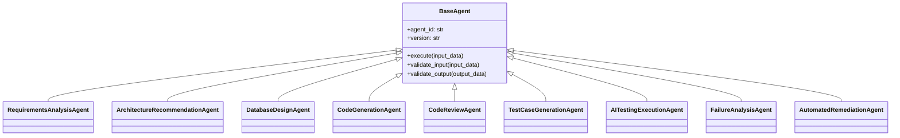
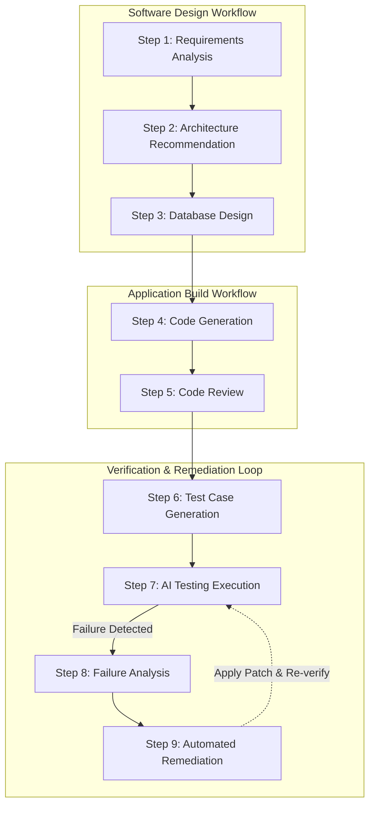
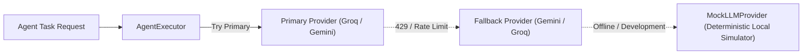

# SE IntelliPlatform — AI Agent Architecture & Orchestration
**Autonomous Multi-Agent System, Execution Contracts, and LLM Provider Resilience**

---

## 1. Autonomous Agent Matrix

SE IntelliPlatform incorporates **9 specialized AI engineering agents**, each encapsulating a dedicated domain within the Software Development Lifecycle:

### Detailed Agent Profiles

| # | Agent Name | Inputs | Outputs | Primary Responsibility |
| :-: | :--- | :--- | :--- | :--- |
| **1** | **Requirements Analysis** | Unstructured prompt / PRD | Validated Requirements & User Journeys | Normalizes feature requests, user stories, and acceptance criteria. |
| **2** | **Architecture Recommendation** | Functional requirements | Architectural Style & Component Topology | Derives design patterns (Hexagonal, Clean, Event-Driven) and service boundaries. |
| **3** | **Database Design** | Domain model specifications | Entity-Relationship Blueprint & DDL | Synthesizes normalized database schemas, primary/foreign keys, and indexes. |
| **4** | **Code Generation** | Architecture & DB schema | Polyglot source code files & configs | Generates full-stack boilerplate, backend routes, frontend views, and Dockerfiles. |
| **5** | **Code Review** | Generated source files | Security, lint, and AST findings | Identifies vulnerabilities (OWASP Top 10), smells, and style deviations. |
| **6** | **Test Generation** | Source code & contracts | Unit, integration & E2E tests | Synthesizes Pytest, Vitest, and Playwright test suites targeting high coverage. |
| **7** | **AI Testing Execution** | Test suites & environment | Test execution telemetry & logs | Executes test suites inside sandboxed containers and records pass/fail metrics. |
| **8** | **Failure Analysis** | Container logs & stack traces | Root cause diagnosis & blast radius | Isolates runtime exceptions, missing imports, and logic faults. |
| **9** | **Automated Remediation** | Root cause diagnosis | Unified code diffs & patch tokens | Generates self-healing code patches and automatically applies verified fixes. |

---

## 2. Dynamic Workflow Orchestration Engine

Workflows are executed by the `WorkflowCoordinator` (`app/workflows/coordinator.py`). Pipelines are defined as Directed Acyclic Graphs (DAGs) of steps, where downstream agents depend on outputs of upstream agents:

### Execution Modes
1. **Synchronous Execution (`POST /workflows/{id}/execute`)**: Ideal for lightweight local testing or automated unit test fixtures.
2. **Asynchronous Execution (`POST /workflows/{id}/execute-async`)**: Dispatches workflow in background task with DB state tracking; provides real-time polling (`/status`) and Server-Sent Events (`/stream`).

---

## 3. LLM Provider Architecture & Fault-Tolerant Fallback

The platform abstracts language model execution behind the `AbstractLLMProvider` interface (`app/agents/providers/base.py`):

### Provider Capabilities:
1. **MockLLMProvider**:
   - Bundles pre-registered, fully validated candidate outputs for all 9 agents.
   - Requires zero network connection, zero API keys, and zero cloud spend.
   - Guarantees 100% test reproducibility across CI/CD and academic grading environments.
2. **GroqProvider**:
   - Ultra-low latency inference using open-source models (`llama-3.3-70b-versatile`, `deepseek-r1-distill-llama-70b`).
3. **GeminiProvider**:
   - Google Gemini API with native Pydantic schema enforcement and multi-modal understanding.

---

## 4. Self-Healing Closed Remediation Loop

When a test failure occurs during automated verification:
1. `AITestingExecutionAgent` captures exit codes, stderr, and container logs.
2. `FailureAnalysisAgent` maps stack trace line numbers to AST nodes.
3. `AutomatedRemediationAgent` computes a contextual patch in Unified Diff format.
4. The patch is applied to a candidate version and re-submitted to `AITestingExecutionAgent`.
5. Upon achieving all passing tests, the healed version is promoted to `ACTIVE`.
