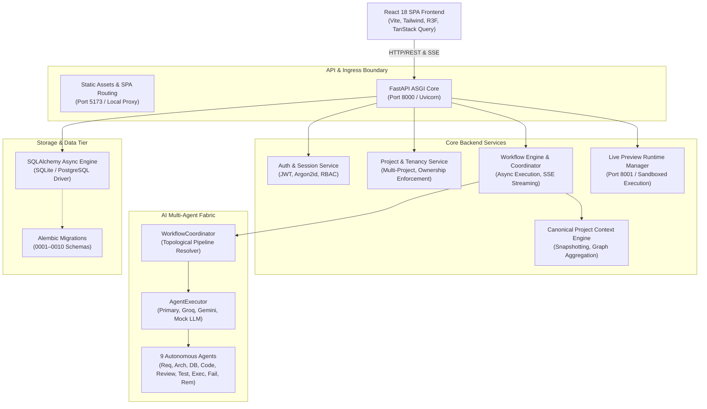
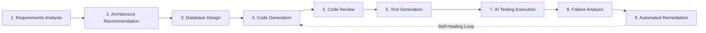

# SE IntelliPlatform — Final Architecture Reference
**Autonomous Multi-Agent Software Engineering Capstone Platform**

---

## 1. Executive System Overview

SE IntelliPlatform is an academic capstone platform engineered to demonstrate autonomous, multi-agent AI orchestration across the complete Software Development Lifecycle (SDLC). The system unites 9 specialized AI agents, interactive 2D engineering views, and 7 hardware-accelerated 3D volumetric visualizers to provide dual operating experiences:

1. **User Mode (Beginner / Product View)**: Conversational requirements elicitation, automated app building, one-click template starter workflows, and live isolated container preview execution.
2. **Developer Mode (Engineering Cockpit)**: 16 modular workspaces spanning code editing, static analysis, automated testing, risk evaluation, DAG workflows, code intelligence, and 3D architectural blueprints.

The architecture emphasizes **local-first execution**, requiring zero paid third-party subscriptions or cloud infrastructure to build, test, and demonstrate.

---

## 2. High-Level System Architecture Diagram

---

## 3. Technology Stack Inventory

| Tier | Technology | Purpose & Selection Rationale |
| :--- | :--- | :--- |
| **Frontend Framework** | React 18.3 (TypeScript) | Declarative UI, StrictMode concurrency, robust ecosystem. |
| **Build & Bundle** | Vite 5.4 | Sub-second HMR, Rollup chunk splitting, vendor isolation. |
| **State & Cache** | TanStack React Query v5 | Server state caching, optimistic updates, query invalidation. |
| **3D Rendering** | Three.js & React Three Fiber (R3F) | WebGL volumetric visualization with fallback SVG renderers. |
| **Design & UI** | Tailwind CSS & Lucide Icons | Responsive styling, dark mode theme tokens, clean accessibility. |
| **Backend Framework** | FastAPI 0.115 (Python 3.12+) | Async ASGI runtime, OpenAPI auto-docs, Pydantic v2 validation. |
| **ORM & Database** | SQLAlchemy 2.0 Async + aiosqlite | Type-safe async query builder, SQLite / Postgres compatibility. |
| **Migrations** | Alembic 1.13 | Deterministic schema versioning with safe pre-execution script. |
| **Security & Auth** | Argon2id & PyJWT | Cryptographically hardened password hashing and stateless tokens. |
| **Runtime Sandbox** | Docker Engine API / Local Mock | Ephemeral isolated code execution and live application previews. |

---

## 4. Multi-Agent SDLC Orchestration Engine

The core reasoning capability is distributed across **9 specialized AI agents**:

1. **Requirements Analysis Agent**: Parses unstructured human user prompts into validated functional, non-functional, and user journey specifications.
2. **Architecture Recommendation Agent**: Selects architectural style (Clean, Microservices, Hexagonal) and derives component topology.
3. **Database Design Agent**: Synthesizes entity-relationship schemas, field data types, primary/foreign keys, and indexes.
4. **Code Generation Agent**: Synthesizes production-ready boilerplate, application logic, and configuration files.
5. **Code Review Agent**: Performs static rule and AST evaluation, reporting security, architectural, and quality issues.
6. **Test Case Generation Agent**: Generates unit, integration, and contract tests targeting comprehensive branch coverage.
7. **AI Testing Execution Agent**: Dispatches test suites against the sandboxed runtime environment and collects telemetry.
8. **Failure Analysis Agent**: Diagnoses stack traces, logs, and AST anomalies to identify root causes and blast radiuses.
9. **Automated Remediation Agent**: Formulates precision diffs and code patches to automatically heal broken test cases.

---

## 5. 3D Volumetric Visualization Architecture

SE IntelliPlatform incorporates 7 dedicated WebGL 3D volumetric scenes built on Three.js and React Three Fiber:

| # | Visualizer Name | View / Workspace | Description |
| :-: | :--- | :--- | :--- |
| **1** | **Global Ambient Mesh** | Global Background | Responsive geometric particle matrix adapting to platform mode. |
| **2** | **Project Topology** | Overview Workspace | Spherical cosmos representing project files, dependencies, and health. |
| **3** | **Code Studio Visualizer** | Code Studio | Cylindrical helix mapping module hierarchy and complexity metrics. |
| **4** | **Testing Topology** | Testing Intelligence | Orbiting status rings displaying unit, integration, and E2E pass rates. |
| **5** | **Workflow DAG Cosmos** | Workflow Studio | 3D directed acyclic graph mapping agent execution states and progress. |
| **6** | **Architecture & ERD Blueprint** | Specifications Workspace | Multi-tiered volumetric blueprint of platform services and database schemas. |
| **7** | **Code Intelligence Explorer** | Code Intelligence | 3D celestial graph mapping symbol dependencies, imports, and modules. |

Every 3D viewer implements **graceful degradation**, offering accessible, high-contrast SVG fallbacks for low-power laptops and devices without WebGL acceleration.
