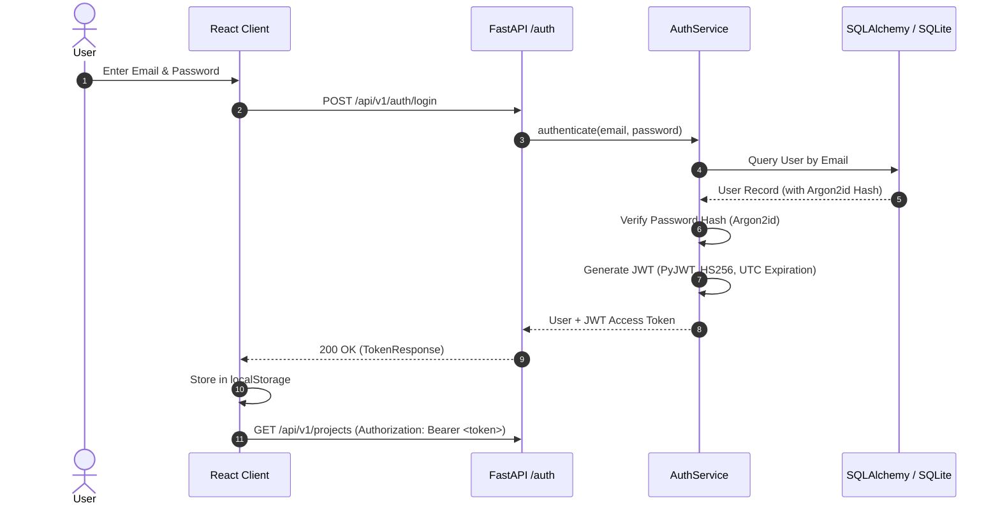

# SE IntelliPlatform — Security & Authorization Architecture
**Application Security Posture, Authentication Lifecycle, and Access Control Policies**

---

## 1. Security Philosophy & Threat Model

SE IntelliPlatform is engineered as a secure-by-default software engineering platform. Because software development platforms accept and generate source code, the system establishes rigid perimeter defenses to protect against:

1. **Broken Object Level Authorization (BOLA)**: Unauthorized cross-project access or tampering.
2. **Credential & Secret Exposure**: Insecure default secrets or leaked tokens.
3. **Denial of Service (DoS) & Brute Force**: Unrestricted submission to authentication and workflow engines.
4. **Code Injection**: Execution of unsanitized arbitrary scripts or payloads.

---

## 2. Production Secret Key Validation (Phase 6D Hardening)

To prevent misconfiguration in deployed environments, `app/core/config.py` enforces cryptographic secret invariants at startup:

```python
# Production and Staging Enforcement Rule
if self.ENVIRONMENT in ("production", "staging"):
    if not self.SECRET_KEY or self.SECRET_KEY in INSECURE_DEFAULT_SECRETS:
        raise ValueError("FATAL: SECRET_KEY must be configured in production/staging.")
    if len(self.SECRET_KEY) < 32:
        raise ValueError("FATAL: SECRET_KEY must be at least 32 characters in production/staging.")
```

- In **development** and **testing**, a safe development key is provided to ensure out-of-the-box local developer ergonomics.
- In **production** and **staging**, the application refuses to start if `SECRET_KEY` is missing, short, or matches known default values.

---

## 3. Authentication & Token Management



- **Password Hashing**: Hardened using `argon2id` (memory-hard against GPU brute force).
- **Access Tokens**: Stateless JSON Web Tokens (JWT) signed using HMAC-SHA256 (`HS256`).
- **Session Revocation**: Tokens carry explicit UTC expiration timestamps (`exp`) and subject UUIDs (`sub`).

---

## 4. Multi-Tenancy & Project Ownership Authorization

Project ownership is enforced in two complementary layers:

### Layer A: FastAPI Route Dependency (`get_authorized_project`)
Before any project operation executes, the project is resolved and validated:

```python
async def get_authorized_project(
    project_id: uuid.UUID,
    current_user: User | None = Depends(get_current_user_optional),
    session: AsyncSession = Depends(get_db),
) -> Project:
    project = await session.get(Project, project_id)
    if not project:
        raise NotFoundError("Project", str(project_id))

    is_admin = current_user is not None and current_user.role == UserRole.ADMIN

    if project.owner_id is not None:
        is_owner = current_user is not None and str(project.owner_id) == str(current_user.id)
        if not (is_owner or is_admin):
            raise ForbiddenError("You do not have permission to access this project.")
    else:
        # Unowned / legacy project policy:
        if settings.ENVIRONMENT in ("production", "staging") and not is_admin:
            raise ForbiddenError("Unowned or system projects can only be accessed by an Administrator in production.")

    return project
```

### Layer B: Domain Service Level (`check_project_authorization`)
Endpoints performing modifications (`update`, `archive`, `restore`, `duplicate`, `permanent_delete`) call `check_project_authorization(project, current_user, action="modify")` to ensure uniform policy enforcement across all access paths.

---

## 5. Rate Limiting & Abuse Prevention

A local-first, sliding window rate limiter protects critical platform ingress points without requiring external infrastructure (`app/core/rate_limit.py`):

| Target Endpoint | Quota | Sliding Window | Policy on Breach |
| :--- | :--- | :--- | :--- |
| `POST /api/v1/auth/login` | 10 requests | 60 seconds | 429 Too Many Requests (`Retry-After`) |
| `POST /api/v1/auth/register` | 5 requests | 60 seconds | 429 Too Many Requests (`Retry-After`) |
| `POST /api/v1/workflows/*/execute*` | 20 requests | 60 seconds | 429 Too Many Requests (`Retry-After`) |

- **Local Memory Store**: Zero external Redis dependency required; thread-safe sliding window tracking.
- **Redis Fallback**: Seamlessly switches to Redis if `REDIS_URL` is set in production.
- **Automated Test Immunity**: Rate limits automatically bypass when `ENVIRONMENT == "testing"`, ensuring test suites never experience false throttling.

---

## 6. RFC 7807 Error Sanitization

All API exceptions are transformed into standard RFC 7807 Problem Details payloads (`Content-Type: application/problem+json`). Internal stack traces, raw SQL queries, and filesystem paths are strictly stripped from client responses and routed exclusively to server-side structured audit logs.
