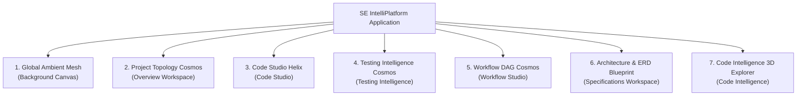

# SE IntelliPlatform — 3D Workspace & Visual Computing Guide
**Comprehensive Reference to the 7 Three.js & React Three Fiber (R3F) Volumetric Environments**

---

## 1. Overview & Rendering Philosophy

SE IntelliPlatform integrates hardware-accelerated 3D volumetric visual computing into software engineering workflows. Rather than treating codebases as flat directory trees, the platform represents software architecture, database relations, workflow DAGs, and test suites as interactive spatial topologies.

### Core Rendering Technology
- **Three.js**: WebGL rendering engine providing geometry, shaders, lighting, and camera pipelines.
- **React Three Fiber (R3F)**: Declarative React reconciler for Three.js, synchronizing React state directly with the 3D scene graph.
- **@react-three/drei**: Specialized camera controls (`OrbitControls`), text billboards, and procedural shaders.

---

## 2. Catalog of All 7 3D Volumetric Scenes

### 1. Global Ambient Mesh (`GlobalCanvas.tsx`)
- **Location**: Global background behind all workspaces.
- **Visual Mechanics**: A floating parametric particle field with subtle wave displacement.
- **Mode Adaptation**: Automatically transitions color palette based on active mode (Cyan/Emerald in User Mode; Indigo/Violet in Developer Mode).

### 2. Project Topology Cosmos (`ProjectTopologyViewer.tsx`)
- **Location**: `OverviewWorkspace.tsx`
- **Visual Mechanics**: A celestial spherical galaxy representing the active project.
- **Interactivity**: Clicking the central project star opens health metrics; orbiting module planets reflect line count, complexity, and test coverage through glowing atmospheric halos.

### 3. Code Studio 3D Visualizer (`CodeStudioWorkspace.tsx`)
- **Location**: `CodeStudioWorkspace.tsx`
- **Visual Mechanics**: A vertical double-helix or cylindrical ring structure mapping source files by folder depth.
- **Integration**: Clicking any 3D node selects and opens that exact source file in the Monaco code editor.

### 4. Testing Intelligence Cosmos (`TestingIntelligenceViewer.tsx`)
- **Location**: `TestingWorkspace.tsx`
- **Visual Mechanics**: Concentric orbital rings dividing tests by tier:
  - *Inner Ring*: Unit Tests (Green = Passed, Red = Failed, Amber = Pending).
  - *Middle Ring*: Integration & Contract Tests.
  - *Outer Ring*: End-to-End & Browser Journey Tests.
- **Telemetry**: Selecting any sphere exposes execution time, stack traces, and failure analysis triggers.

### 5. Workflow DAG 3D Viewer (`WorkflowDag3DViewer.tsx`)
- **Location**: `WorkflowStudio.tsx`
- **Visual Mechanics**: A 3D directed acyclic graph with glowing animated pulses flowing along dependency edges.
- **State Feedback**: Nodes pulse brightly when agents are active (`RUNNING`), turn emerald on completion, or crimson on failure.

### 6. Architecture & ERD 3D Blueprint Cosmos (`ArchitectureBlueprint3DViewer.tsx`)
- **Location**: `SpecificationWorkspace.tsx`
- **Dual Visual Modes**:
  1. **Platform Architecture**: 3 tiered horizontal strata:
     - *Top Tier*: Client & Ingress (React SPA, Nginx).
     - *Middle Tier*: Application & Agent Services (FastAPI, Workflow Coordinator).
     - *Bottom Tier*: Persistence & Infrastructure (SQLite, Docker Runtime).
  2. **Project ERD Blueprint**: Volumetric entity cards floating in space, connected by glowing cubic Bezier curves representing Foreign Key relationships. Cardinality badges (`1:N`, `N:M`) display along relationship lines.
- **Source Selection & Data Provenance**: Distinct toggle between Canonical Platform Infrastructure and Generated Project Architecture, featuring an honest empty state with a "Run Software Design Workflow" action when no project architecture has been generated.

### 7. Code Intelligence 3D Graph Explorer (`CodeTopologyViewer.tsx`)
- **Location**: `CodeIntelligenceWorkspace.tsx`
- **Visual Mechanics**: A force-directed 3D constellation mapping cross-file dependencies, imports, and symbol definitions.
- **Dual View Support**: One-click toggle between classic 2D Adjacency Matrix and 3D Cosmos.
- **Synchronized Inspection**: Clicking any node opens the module inspector drawer with direct "Open in Editor" navigation to Code Studio.

---

## 3. Performance & Laptop Optimization Strategies

1. **Lazy Loading (`React.lazy`)**: 3D viewers are dynamically imported on demand, preventing heavy WebGL bundles from delaying initial page load.
2. **Chunk Splitting (`vendor-three.js`)**: Three.js and R3F are isolated into a standalone vendor chunk (`835 kB` raw / `225 kB` gzipped), cached aggressively by browsers.
3. **Canvas Cleanup & Resource Disposal**: Every viewer registers explicit unmount hooks (`scene.clear()`, `renderer.dispose()`, `geometry.dispose()`) to prevent WebGL context exhaustion when switching workspaces.
4. **Accessible 2D SVG Fallbacks**: Every 3D viewer includes an integrated Accessible 2D Fallback view for low-power laptops or browsers with disabled hardware acceleration.
