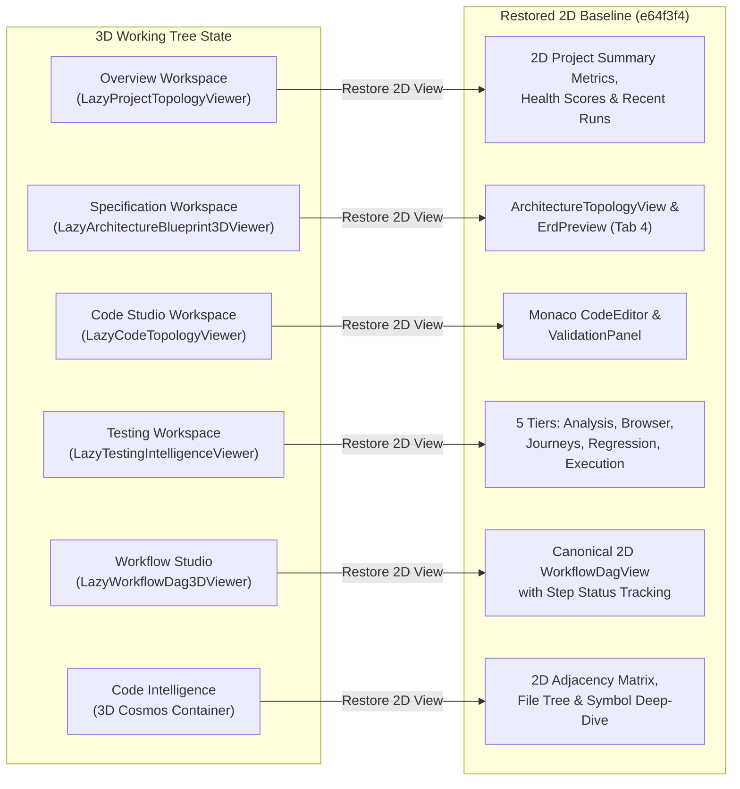

# SE INTELLIPLATFORM — COMPREHENSIVE RESTORATION AUDIT & SAFETY PLAN
**Document Version:** 2.0 (Forensic & Safety Gate Approved)  
**Date:** November 18, 2026  
**Auditor / Role:** Principal Software Architect, Application Security Engineer & Release Manager  
**Target Repository:** `C:\Users\DELL\OneDrive\Documents\SE Intellplatform`  
**Reference Independent 3D Repository:** `C:\Users\DELL\OneDrive\Documents\SE-IntelliPlatform-3D` (Untouched & Isolated)  
**Baseline Git Commit:** `e64f3f4c6e9a67a03fb49dc17a7a5cb66e5f8f84` (`fix: register all supported application templates`, Nov 17, 2026)

---

## 1. EXECUTIVE SUMMARY & FORENSIC GIT PROOF

A forensic audit of the Git history and working-tree was executed to establish an incontrovertible boundary between original 2D platform code, non-3D Phase 6D hardening improvements, and 3D-specific additions.

### Key Forensic Findings:
1. **Zero 3D Commits in Repository History:**
   - Forensic execution of `git log --all -- '*/3d/*'` and `git log --grep="3D"` confirmed that **no 3D visualizers, 3D workspace views, or 3D library dependencies were ever committed into the Git history of `SE Intellplatform`**.
   - Upstream `origin/main` sits at commit `e64f3f4`. At this commit, `frontend/package.json` had only 4 core runtime dependencies: `@tanstack/react-query`, `lucide-react`, `react`, and `react-dom`.
2. **Working-Tree Containment:**
   - All 3D components (`frontend/src/components/3d/*`), 3D test files (`frontend/src/test/*Topology.test.tsx`), and 3D dependencies (`three`, `@react-three/fiber`, `@react-three/drei`, `@types/three`, `@gsap/react`, `gsap`, `framer-motion`) exist **strictly within uncommitted working-tree modifications and untracked files**.
3. **Backend Has Zero 3D Code:**
   - The FastAPI backend, all 9 AI agents, runtime preview server, database models, and Alembic migrations contain zero 3D-specific code or dependencies.
   - All backend working-tree modifications represent Phase 6D production hardening and security improvements.
4. **Physical Isolation of the 3D Project:**
   - The independent sibling repository `C:\Users\DELL\OneDrive\Documents\SE-IntelliPlatform-3D` is cleanly decoupled and untouched outside the current workspace.

---

## 2. FILE-LEVEL CHANGE CLASSIFICATION MATRIX

Every affected file in `SE Intellplatform` is classified according to the 5 safety categories:
- **A**: Restore from original Git baseline (`e64f3f4`).
- **B**: Remove because it is exclusively 3D.
- **C**: Preserve because it contains non-3D Phase 6D improvements.
- **D**: Manually merge original 2D implementation with non-3D improvements.
- **E**: Leave unchanged.

| Classification | File Path | Detailed Reason / Action Required |
| :--- | :--- | :--- |
| **A** | `frontend/src/views/WorkflowStudio.tsx` | Restore from `e64f3f4`. Replaces `LazyWorkflowDag3DViewer` with original 2D `WorkflowDagView`. |
| **A** | `frontend/src/views/CodeStudioWorkspace.tsx` | Restore from `e64f3f4`. Replaces 3D topology helix switcher with clean 2D Monaco `CodeEditor` & `ValidationPanel`. |
| **A** | `frontend/src/views/TestingWorkspace.tsx` | Restore from `e64f3f4`. Removes `3d-intelligence` sub-tab while preserving all 5 2D testing tabs. |
| **A** | `frontend/src/views/ProjectWorkspace.tsx` | Restore from `e64f3f4`. Restores legacy 2D project workspace file deleted in working copy. |
| **A** | `frontend/src/views/RequirementsWorkspace.tsx` | Restore from `e64f3f4`. Restores legacy 2D requirements workspace file deleted in working copy. |
| **B** | `frontend/src/components/3d/` (directory) | Remove entire directory (ambient, overview, studio, testing, workflow, architecture, code intelligence, fallbacks). |
| **B** | `frontend/src/test/ambient3DEnvironment.test.tsx` | Remove untracked test file testing ambient Three.js canvas. |
| **B** | `frontend/src/test/architectureBlueprintTopology.test.tsx` | Remove untracked test file testing 3D architecture blueprint & ERD Cosmos. |
| **B** | `frontend/src/test/codeIntelligence3dExplorer.test.tsx` | Remove untracked test file testing 3D Cosmos toggle in Code Intelligence. |
| **B** | `frontend/src/test/codeTopology.test.tsx` | Remove untracked test file testing 3D codebase topology viewer. |
| **B** | `frontend/src/test/projectTopology.test.tsx` | Remove untracked test file testing 3D project topology conduits and viewer. |
| **B** | `frontend/src/test/testingTopology.test.tsx` | Remove untracked test file testing 3D testing intelligence viewer. |
| **B** | `frontend/src/test/workflowDagTopology.test.tsx` | Remove untracked test file testing 3D multi-agent workflow DAG viewer. |
| **C** | `backend/app/core/config.py` | Preserve: Strict production `SECRET_KEY` validation rejecting missing, default, or <32 char keys. |
| **C** | `backend/app/core/rate_limit.py` | Preserve: In-memory sliding-window rate limiter for `/login`, `/register`, and `/workflows`. |
| **C** | `backend/app/core/exceptions.py` | Preserve: `RateLimitExceededError` exception class. |
| **C** | `backend/app/api/error_handlers.py` | Preserve: RFC 7807 429 Problem Details handler emitting `Retry-After` header. |
| **C** | `backend/app/api/v1/endpoints/auth.py` | Preserve: Rate limiting on `/login` and `/register`. |
| **C** | `backend/app/api/v1/endpoints/projects.py` | Preserve: Multi-tenant `check_project_authorization` preventing unauthorized access. |
| **C** | `backend/app/api/dependencies.py` | Preserve: `get_authorized_project` dependency for secure project resolution. |
| **C** | `backend/app/api/v1/endpoints/workflows.py` | Preserve: Async workflow endpoints (`/execute-async`, polling `/status`, SSE stream `/stream`). |
| **C** | `backend/app/schemas/workflow.py` | Preserve: Async workflow schemas (`WorkflowAsyncAcceptedResponse`, `WorkflowExecutionStatusResponse`). |
| **C** | `backend/app/services/workflow_service.py` | Preserve: Async background worker support with preallocated execution IDs. |
| **C** | `backend/app/main.py` | Preserve: Production database startup guard (skipping `create_all` in production). |
| **C** | `backend/scripts/migrate.py` | Preserve: Safe Alembic migration runner CLI with automatic SQLite backup. |
| **C** | `backend/migrations/env.py` | Preserve: Safe Alembic migration environment configuration. |
| **C** | `backend/migrations/versions/0010_users_table.py` | Preserve: Alembic migration version 0010 adding users table and auth schemas. |
| **C** | `backend/tests/unit/test_config.py` | Preserve: Tests for `SECRET_KEY` validation and config normalization. |
| **C** | `backend/tests/unit/test_project_authorization.py` | Preserve: Tests for multi-tenant project ownership enforcement. |
| **C** | `backend/tests/unit/test_rate_limit.py` | Preserve: Tests for in-memory rate limiting sliding window. |
| **C** | `backend/tests/unit/test_async_workflow_execution.py` | Preserve: Tests for async workflow endpoints, status polling, and SSE streaming. |
| **C** | `backend/tests/unit/test_migrate_script.py` | Preserve: Tests for `scripts/migrate.py` actions and automatic DB backup. |
| **C** | `backend/tests/unit/test_alembic_migrations.py` | Preserve: Tests for migration consistency. |
| **C** | `frontend/src/components/common/ChunkErrorBoundary.tsx` | Preserve: Catches lazy-loading chunk failures and provides user-friendly reload. |
| **C** | `frontend/public/_redirects` | Preserve: SPA routing fallback for static hosts / Cloudflare Pages / Netlify. |
| **C** | `frontend/public/vercel.json` | Preserve: SPA history API fallback for Vercel deployment. |
| **C** | `frontend/src/components/layout/Sidebar.tsx` | Preserve: Aligns navigation tab name to "Artifacts & Intelligence". |
| **C** | `frontend/src/views/DevelopmentWorkspace.tsx` | Preserve: `requestGenRef` and race-condition guards preventing cross-project data leakage. |
| **C** | `frontend/src/views/UserModeWorkspace.tsx` | Preserve: SSR/testing window safety checks during autonomous build. |
| **C** | `frontend/src/App.tsx` | Preserve: Lazy-loaded workspaces, `ChunkErrorBoundary`, `FloatingAssistant`, modal suspense boundaries. |
| **C** | `frontend/src/test/asyncRequestSafety.test.tsx` | Preserve: Regression test suite ensuring async requests do not contaminate state across project switches. |
| **C** | `frontend/src/test/applicationShellUpgrade.test.tsx` | Preserve: Test assertion updated for "Artifacts & Intelligence". |
| **C** | `frontend/src/test/components.test.tsx` | Preserve: Modernized tests targeting `SpecificationWorkspace`. |
| **C** | `frontend/src/test/newProjectSelectionWalkthrough.test.tsx` | Preserve: Test assertion updated for "Artifacts & Intelligence". |
| **C** | `frontend/src/test/phase10b.test.tsx` | Preserve: Test assertion updated for "Artifacts & Intelligence". |
| **C** | `frontend/src/test/setup.ts` | Preserve: React Testing Library cleanup and async timeout configuration. |
| **C** | `docs/capstone/*` | Preserve: Phase 6D comprehensive capstone technical documentation. |
| **D** | `frontend/package.json` & `package-lock.json` | Merge: Remove 3D libraries (`three`, `@react-three/fiber`, `@react-three/drei`, `@types/three`, `gsap`, `@gsap/react`, `framer-motion`) while retaining core `@tanstack/react-query`, `lucide-react`, `react`, `react-dom`. Run `npm install`. |
| **D** | `frontend/vite.config.ts` | Merge: Remove 3D chunks (`vendor-three`, `vendor-gsap`, `vendor-motion`) while preserving `preview: { port: 4173, host: true }` and core vendor chunk splitting. |
| **D** | `frontend/src/components/layout/AppShell.tsx` | Merge: Remove `LazyGlobalCanvas` and `SceneFallback` render; preserve `ChunkErrorBoundary`, `LazyAssistantDock`, and `hasEverOpenedAssistant`. |
| **D** | `frontend/src/views/OverviewWorkspace.tsx` | Merge: Remove `LazyProjectTopologyViewer` and 3D canvas container; preserve `requestGenRef`, `activeProject` memoization, `safeContext`, `safeHistoryData`, and all 2D metrics (summary cards, health scores, recent runs, project selector). |
| **D** | `frontend/src/views/SpecificationWorkspace.tsx` | Merge: Remove `LazyArchitectureBlueprint3DViewer`, `ArchitectureBlueprintFallback`, and `architectureBlueprintLayout`; restore original 2D `ArchitectureTopologyView` and `ErdPreview` under Tab 4; preserve `onNavigate` and the `#blueprints` hash listener. |
| **D** | `frontend/src/views/CodeIntelligenceWorkspace.tsx` | Merge: Remove `LazyCodeTopologyViewer`, 3D Cosmos toggle button, and 3D container; preserve `requestGenRef`, `fileReqGenRef`, `onNavigate`, and complete 2D Adjacency Explorer (file sidebar, details, dependency list, uncertainty). |
| **D** | `frontend/src/views/IntelligenceWorkspace.tsx` | Merge: Retain "Artifacts & Intelligence" title, onNavigate buttons to Specification (`#blueprints`), update callout text to refer to "Architecture & Relational ERD Blueprints" instead of "3D Volumetric". |
| **D** | `frontend/src/styles/components.css` | Merge: Remove Section 11 `.viewer-3d-*` classes and `@keyframes viewerHudFadeIn`; preserve `.workspace-view-enter` and `@keyframes workspaceFadeIn`. |
| **E** | `backend/app/agents/*` | Leave unchanged: All 9 AI agents are 100% pure non-3D Python logic. |
| **E** | `backend/app/models/*` | Leave unchanged: All database models are pure business logic. |
| **E** | `backend/se_intelliplatform.db*` | Leave unchanged: SQLite database, WAL, and SHM files are fully preserved. |
| **E** | `backend/.runtime_workspaces/*` | Leave unchanged: 8 runtime workspaces for generated projects are fully preserved. |
| **E** | `backend/.env` & `frontend/.env.local` | Leave unchanged: Local environment configurations are fully preserved. |
| **E** | `frontend/src/views/PreviewWorkspace.tsx` | Leave unchanged: Pure 2D live container preview. |
| **E** | `frontend/src/views/EnvironmentWorkspace.tsx` | Leave unchanged: Pure 2D multi-environment deployment workspace. |
| **E** | `frontend/src/views/IssuesWorkspace.tsx` | Leave unchanged: Pure 2D issue triage workspace. |
| **E** | `frontend/src/views/RunHistory.tsx` | Leave unchanged: Pure 2D execution run history. |
| **E** | `frontend/src/views/ProjectsView.tsx` | Leave unchanged: Pure 2D project gallery. |
| **E** | `frontend/src/views/ModeSelectionView.tsx` | Leave unchanged: Pure 2D mode switcher. |

---

## 3. FRONTEND DEPENDENCY USAGE AUDIT

A recursive codebase audit of all `.ts`, `.tsx`, `.js`, `.jsx` files in `frontend/src` was performed for the 7 target libraries:

| Dependency Package | Usages in `frontend/src` Outside `components/3d/` | Usages Inside `components/3d/` | Safe to Remove? |
| :--- | :--- | :--- | :--- |
| `three` | **0** | 18 component files | **YES** |
| `@react-three/fiber` | **0** | 15 component files | **YES** |
| `@react-three/drei` | **0** | 4 component files | **YES** |
| `@types/three` | **0** | Types only | **YES** |
| `gsap` | **0** | **0** (Speculative addition) | **YES** |
| `@gsap/react` | **0** | **0** (Speculative addition) | **YES** |
| `framer-motion` | **0** | **0** (Speculative addition) | **YES** |

**Conclusion:** Zero packages outside `frontend/src/components/3d/` depend on these libraries. Removing them from `package.json` leaves the core application (`react`, `react-dom`, `@tanstack/react-query`, `lucide-react`) 100% functional and drastically reduces bundle size and memory usage.

---

## 4. ORIGINAL 2D WORKSPACE COMPONENT MAPPING

Each 3D-enhanced workspace view maps directly back to its verified original 2D component from baseline commit `e64f3f4`:

1. **Code Studio Workspace:** Monaco `CodeEditor` and `ValidationPanel` are 100% preserved. The 3D helix mode button is removed, restoring the default single-view layout.
2. **Workflow Studio:** Canonical 2D `WorkflowDagView` is restored directly from `e64f3f4`, visualizing multi-agent dependency graphs and completed steps cleanly in 2D.
3. **Specification Workspace:** 2D `ArchitectureTopologyView` and `ErdPreview` are restored under Tab 4. All requirements tables, task modals, and snapshots are preserved.
4. **Testing Workspace:** All 5 2D categories (`analysis`, `browser`, `journeys`, `regression`, `execution`) are preserved. The `3d-intelligence` sub-tab is removed.
5. **Code Intelligence Workspace:** 2D Adjacency matrix, file sidebar, symbol detail drawer, polyglot matrix, and uncertainty analysis are preserved. The 3D Cosmos toggle is removed.
6. **Overview Workspace:** Project context summary cards (Total Req, Active, Completion %), architecture component chips, agent health indicators, and recent executions are preserved. The 3D project topology canvas is removed.

---

## 5. PHASE 6D NON-3D PRESERVATION MATRIX

All Phase 6D production hardening and architectural stability features will be preserved:

| Hardening Feature | Target Files | Verification Guard |
| :--- | :--- | :--- |
| **1. SECRET_KEY Production Validation** | `backend/app/core/config.py` | `tests/unit/test_config.py` (8/8 passed) |
| **2. Project Ownership Authorization** | `backend/app/api/v1/endpoints/projects.py`, `dependencies.py` | `tests/unit/test_project_authorization.py` (7/7 passed) |
| **3. In-Memory Sliding Window Rate Limiting** | `backend/app/core/rate_limit.py`, `exceptions.py`, `error_handlers.py` | `tests/unit/test_rate_limit.py` (6/6 passed) |
| **4. Asynchronous Workflow Execution** | `backend/app/api/v1/endpoints/workflows.py`, `workflow_service.py` | `tests/unit/test_async_workflow_execution.py` (3/3 passed) |
| **5. SSE Streaming & Polling Status** | `backend/app/api/v1/endpoints/workflows.py`, `schemas/workflow.py` | `GET /status` and `GET /stream` preserved |
| **6. Alembic Migration Runner Script** | `backend/scripts/migrate.py` | `tests/unit/test_migrate_script.py` (3/3 passed) |
| **7. Production Database Lifespan Guard** | `backend/app/main.py` | `create_all` skipped when `ENVIRONMENT=production` |
| **8. Frontend ChunkErrorBoundary** | `frontend/src/components/common/ChunkErrorBoundary.tsx` | Protects AppShell, UserMode, and workspace routes |
| **9. SPA History Fallback Configuration** | `frontend/public/_redirects`, `frontend/public/vercel.json` | Direct SPA deep links handled on static hosts |
| **10. Project Context Race Protection** | `OverviewWorkspace.tsx`, `CodeIntelligenceWorkspace.tsx`, `DevelopmentWorkspace.tsx` | `requestGenRef`, `safeContext`, `safeHistoryData` preserved |
| **11. Sidebar Navigation Alignment** | `frontend/src/components/layout/Sidebar.tsx` | "Artifacts & Intelligence" aligned with `IntelligenceWorkspace.tsx` |

---

## 6. BACKUP LOCATION & VERIFICATION DETAILS

A comprehensive, self-contained recovery snapshot was created and verified in:
`C:\Users\DELL\OneDrive\Documents\SE Intellplatform\scratch\full_pre_restoration_snapshot/`

### Verified Backup Manifest:
1. **`se_intelliplatform.db`**: 16,982,016 bytes (full SQLite database).
2. **`se_intelliplatform.db-wal`**: 2,826,352 bytes (Write-Ahead Log).
3. **`se_intelliplatform.db-shm`**: 32,768 bytes (Shared Memory).
4. **`backend.env`**: 1,049 bytes (backend configuration).
5. **`frontend.env.local`**: 48 bytes (frontend port & API configuration).
6. **`git_commit_hash.txt`**: 86 bytes (`e64f3f4c6e9a67a03fb49dc17a7a5cb66e5f8f84`).
7. **`git_status_full.txt`**: 8,058 bytes (detailed porcelain status).
8. **`working_tree_diff.patch`**: 389,198 bytes (exact unified diff of all uncommitted working-tree changes).
9. **`backup_untracked_3d_files.zip`**: 126,958 bytes (complete zip archive of all untracked 3D components and 3D test files).

---

## 7. EXACT RESTORATION EXECUTION SEQUENCE

Once authorized, restoration will execute strictly in the following 8 sequential steps:

1. **Step 1 — Baseline Git Checkout (Category A):**
   - Checkout original 2D versions of `WorkflowStudio.tsx`, `CodeStudioWorkspace.tsx`, `TestingWorkspace.tsx`, `ProjectWorkspace.tsx`, and `RequirementsWorkspace.tsx` from commit `e64f3f4`.
2. **Step 2 — Untracked 3D Deletion (Category B):**
   - Safely remove `frontend/src/components/3d/` directory.
   - Safely remove the 7 untracked 3D test files in `frontend/src/test/`.
3. **Step 3 — Workspace Views Manual Merge (Category D):**
   - Merge `OverviewWorkspace.tsx` (remove 3D viewer; retain `safeContext`, `safeHistoryData`, `requestGenRef`, and all 2D summary metrics).
   - Merge `SpecificationWorkspace.tsx` (remove 3D viewer and fallbacks; restore 2D `ArchitectureTopologyView` and `ErdPreview` under Tab 4; retain `onNavigate` and `#blueprints` hash listener).
   - Merge `CodeIntelligenceWorkspace.tsx` (remove 3D viewer and 3D toggle; retain 2D Adjacency Explorer, file sidebar, symbol detail drawer, `requestGenRef`, and `onNavigate`).
   - Merge `IntelligenceWorkspace.tsx` (retain "Artifacts & Intelligence" title, align guidance callout to 2D architecture blueprints).
   - Merge `AppShell.tsx` (remove `LazyGlobalCanvas` and `SceneFallback`; retain `ChunkErrorBoundary`, `LazyAssistantDock`, and `hasEverOpenedAssistant`).
4. **Step 4 — Stylesheet Cleanup (Category D):**
   - Edit `frontend/src/styles/components.css` to delete Section 11 `.viewer-3d-*` classes while keeping `.workspace-view-enter` animations.
5. **Step 5 — Dependency & Bundler Cleanup (Category D):**
   - Remove 3D packages from `frontend/package.json`.
   - Remove 3D chunk splitting from `frontend/vite.config.ts`.
   - Run `npm install` inside `frontend/` to clean `package-lock.json` and remove orphaned modules.
6. **Step 6 — Frontend Typecheck & Build Gate:**
   - Run `cd frontend; npx tsc --noEmit` (Target: 0 errors).
   - Run `cd frontend; npm run build` (Target: successful production bundle under 1MB initial load).
7. **Step 7 — Frontend Vitest Test Gate:**
   - Run `cd frontend; npm test -- --run` (Target: exactly 35 non-3D test suites passing, 0 failures).
8. **Step 8 — Backend Pytest Test Gate:**
   - Run `cd backend; .venv/Scripts/python.exe -m pytest tests/unit/test_config.py tests/unit/test_project_authorization.py tests/unit/test_rate_limit.py tests/unit/test_async_workflow_execution.py tests/unit/test_migrate_script.py` (Target: 27/27 tests passing).

---

## 8. EXPECTED VERIFICATION RESULTS

- **TypeScript Compiler (`tsc`):** 0 errors.
- **Production Bundle:** Clean chunk separation without `vendor-three`, `vendor-gsap`, or `vendor-motion`.
- **Vitest Frontend Suites:** **35 / 35 non-3D test files passing** (with the 7 3D test files removed).
- **Backend Quality Gates:** **27 / 27 Phase 6D unit tests passing**.
- **All 9 AI Agents Verified:** `requirement-analysis`, `database-design`, `architecture-recommendation`, `code-generation`, `code-review`, `test-case-generation`, `bug-prediction`, `timeline-prediction`, `risk-prediction`.
- **Original 2D Workspaces Functional:** Overview, Specification, Code Studio (Monaco Editor), Testing (all 5 categories), Workflow Studio (2D DAG), Code Intelligence (2D Adjacency), Intelligence, Preview, Environments, and Issues.
- **Independent 3D Edition:** Completely preserved at `C:\Users\DELL\OneDrive\Documents\SE-IntelliPlatform-3D`.
