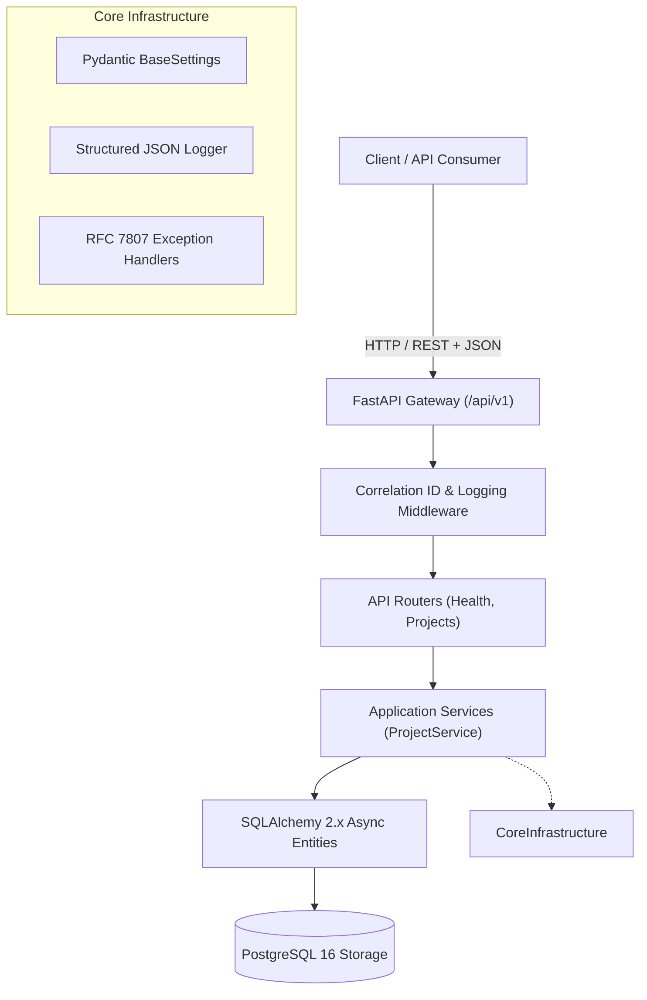

# SE IntelliPlatform — Foundation Architecture Specification

**Status:** Approved Baseline (Phase 1 Implemented)  
**Version:** 0.1.0  
**Authors:** SE IntelliPlatform Core Engineering Team  

---

## 1. System Boundary & Monorepo Overview

SE IntelliPlatform is an AI-powered multi-agent software engineering platform. Phase 1 establishes the deterministic infrastructure and persistence foundation upon which future generative and predictive agents will be mounted.



---

## 2. Backend Architecture

The backend is structured according to clean architecture and separation of concerns:

1. **Presentation / API Layer (`app/api/`):**
   * Translates incoming HTTP requests to typed Pydantic models.
   * Enforces RFC 7807 problem details error responses.
   * Injects dependencies (database sessions, domain services) via FastAPI `Depends`.
   * **Rule:** Route handlers never contain raw SQL queries or direct database mutations.
2. **Domain Services Layer (`app/services/`):**
   * Encapsulates business logic, data validation, and transaction lifecycle.
   * `ProjectService`: Handles project registration, slug conflict validation, pagination, and lifecycle-safe archiving.
3. **Persistence / Entity Layer (`app/models/`):**
   * SQLAlchemy 2.0 Declarative ORM models.
   * Uses UUID primary keys and timezone-aware UTC timestamps.
   * PostgreSQL-native JSONB for semi-structured configurations with sensible defaults.
4. **Core Cross-Cutting Layer (`app/core/`):**
   * Centralized configuration (`config.py`) using `pydantic-settings`.
   * Async database session management (`database.py`).
   * Structured JSON logging and context-variable correlation tracking (`logging.py`).
   * Custom exception hierarchy (`exceptions.py`).

---

## 3. Database Architecture & Persistence Strategy

### Selection: PostgreSQL
* **Justification:** Enterprise software engineering platforms require strict referential integrity across SDLC stages (Requirements → Architecture → Database → Code → Review).
* **Driver:** Asynchronous `psycopg` (v3).
* **Schema Evolution:** Managed via Alembic migrations (`migrations/versions/0001_initial_projects_table.py`).

### Initial Entity: `projects`
* `id` (UUID): Primary key.
* `name` (VARCHAR(255)): Human-readable project title.
* `slug` (VARCHAR(100)): Globally unique URL-safe identifier (indexed).
* `description` (TEXT): Optional project context.
* `status` (VARCHAR(32)): Lifecycle enum (`DRAFT`, `IN_PROGRESS`, `ARCHIVED`).
* `settings` (JSONB): Dynamic configuration dictionary with `{}` server default.
* `created_at` (TIMESTAMP WITH TIME ZONE): UTC creation instant.
* `updated_at` (TIMESTAMP WITH TIME ZONE): UTC update instant.

---

## 4. Configuration Architecture & Fail-Fast Guarantees

* Settings are loaded from environment variables or `.env` file via `Settings(BaseSettings)`.
* **Fail-Fast Enforcement:**
  * When `ENVIRONMENT` is set to `production` or `staging`, the application refuses to start if default credentials (`postgres_password`) or `DEBUG=True` are configured.
  * Incomplete or malformed URLs raise instantaneous startup validation errors before network listeners open.

---

## 5. API Conventions & Error Handling

* **Prefix:** All operational endpoints reside under `/api/v1`.
* **Headers:**
  * Incoming `X-Correlation-ID` or `X-Request-ID` is extracted, attached to logging context, and returned in the HTTP response header `X-Correlation-ID`.
* **Error Format:** Strict adherence to **RFC 7807 (Problem Details for HTTP APIs)**:
  ```json
  {
    "type": "https://api.se-intelliplatform.local/errors/conflict",
    "title": "Resource Conflict",
    "status": 409,
    "detail": "Project with slug 'demo-project' already exists.",
    "instance": "/api/v1/projects",
    "trace_id": "req-9876-abcd-ef01"
  }
  ```

---

## 6. Testing Strategy

1. **Unit Tests:** Verify configuration edge cases, fail-fast rules, and Pydantic validation constraints without database interaction.
2. **Integration Tests:** Use `httpx.AsyncClient` with an async database fixture to test HTTP endpoints, correlation propagation, and error responses end-to-end.
3. **No External Network Calls:** Deterministic test execution with zero external cloud or LLM dependencies.

---

## 7. Future Extension Points (Phase 2+)

* **Project Context Engine (Phase 2):** Single source of truth with immutable snapshot versioning.
* **Deterministic Rule Engine (Phase 2):** Architectural constraints and cost estimation validators.
* **Abstract Agent Interface (Phase 3):** `AbstractBaseAgent` and LLM provider strategy pattern.
* **Redis Task Bus (Phase 3+):** Asynchronous task orchestration and event streaming.
